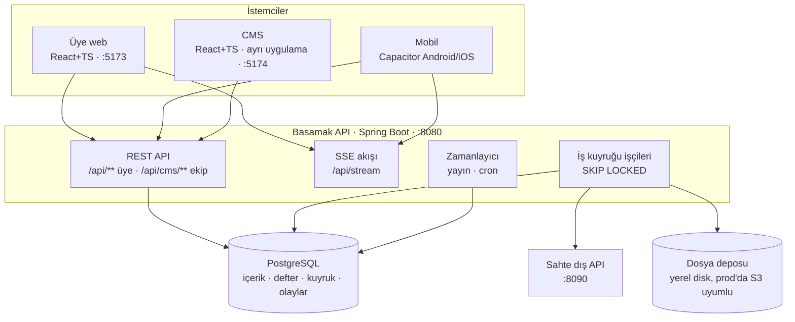

# Basamak — Tasarım Belgesi

> Durum: **canlı belge.** Her geliştirme fazında, o fazda gerçekten alınan kararlarla güncellenir.
> Bir bölümün yanında *(taslak)* yazıyorsa karar verilmiş ama henüz kodda doğrulanmamıştır.
> Kodda doğrulanmış kararlar ilgili test sınıfına bağlantı verir.

## İçindekiler
1. Kapsam, varsayımlar ve yapmadıklarımız
2. Mimari (C4 bağlam ve kap)
3. Veri modeli ve sürümleme
4. Araç ve iş akışı çalıştırma motoru
5. Oyunlaştırma ve puan defteri
6. API sözleşmesi
7. Yetki, güvenlik (OWASP eşlemesi) ve KVKK
8. Mobil: çevrimdışı eşitleme, bildirim, derin bağlantı
9. Ölçeklenme, izleme ve hata yönetimi
10. Mimari karar kayıtları (ADR)
11. İleriye bırakılanlar
12. "Sizin kararınız" — karar listesi
13. Yapay zekâ kullanımı

---

## 1. Kapsam, varsayımlar ve yapmadıklarımız

**Bağlam.** Ödevin normal süresi 10 gün, fiilî teslim süresi ise yaklaşık 21 saat (23.11.2026 14.16 → 24.11.2026 12.00). Kapsam bu süreye göre önceliklendirildi:
P0 çalışan uçtan uca akış → P1 zorunlu senaryoların iş kuralları ve testleri → P2 mobil ve kalan senaryolar → P3 kalite ve ölçüm.
Hangi senaryonun hangi durumda olduğu her zaman `README.md` ve `DURUM.md` içinde dürüstçe yazılıdır.

**Varsayımlar**
- **Sıfır ek maliyet.** Ücretli servis kullanılmaz. Yapay zekâ sağlayıcısı varsayılan olarak `mock`; isteğe bağlı olarak yerel Ollama (ücretsiz) seçilebilir. E-posta Mailpit'e, araçlar kendi yazdığımız sahte servise gider.
- **Tek bölge ve tek veritabanı.** İlk yıl ölçeği (50.000 üye, 2.000 eşzamanlı kullanıcı, günde 20.000 çalıştırma) tek bir PostgreSQL birincil sunucusu ve yatay ölçeklenen, durumsuz uygulama düğümleriyle karşılanabilir (bkz. §9).
- Bütün zamanlar veritabanında UTC olarak saklanır. Gün sınırı (seri, günlük kota, haftalık sıralama) ve zamanlanmış yayın **Europe/Istanbul** saatine göre hesaplanır.
- **Journey seviyesi.** Üyenin seviyesi, açık olan ve henüz bitirmediği en düşük sıralı Journey'dir. Hiçbirini bitirmemişse Beginner'dır.

**Yapmadıklarımız** (gerekçe ve alternatifler için bkz. §11)
- iOS derlemesi ve simülatör testi: Windows makinede yapılamaz. Yapılandırma ve talimat hazırdır ama **test edilmemiştir**. APNs, ücretli Apple Developer hesabı gerektirir.
- Bölüm 3.11 (arama, çok dillilik, kurumsal alanlar): PDF'e göre kodda seçmeli; yalnız tasarımı yapıldı.
- Topluluk özelliklerinin (takip, akış, yorum, moderasyon) arayüzleri ertelendi. Zorunlu senaryolarda yer almıyorlar; tasarım kararları §12'de.

## 2. Mimari

**Modüler monolit** yaklaşımı (gerekçesi ADR-1'de): Tek bir Spring Boot dağıtım birimi var. İçindeki modüller paket sınırlarıyla ayrılır ve birbirlerine yalnız servis arayüzleri üzerinden erişir. Arka plan işçileri aynı ikili dosyada çalışır; işçi sayısı ayarla ölçeklenir ve ayrı bir süreç olarak da başlatılabilir.

### C4 — Bağlam

### C4 — Kaplar

**Modüller:** `auth`, `content` (sürüm ve yayın), `journey`, `learning` (kayıt, ilerleme, quiz, anket), `gamification` (kural, defter, rozet, sıralama), `tool`, `workflow`, `community` (paylaşım ve çatallama), `notification` (SSE, e-posta, push), `report`, `privacy` (dışa aktarma ve silme), `common`.

## 3. Veri modeli ve sürümleme

### 3.1 Varlık–ilişki (F1 itibarıyla kodda olanlar)

### 3.2 Sürümleme modeli: tam kopya (ADR-3)
- Her kayıt yeni bir `content_version` satırı açar. Gövde, içeriğin **tam JSONB kopyasıdır**. Eski satırlar silinmez ve güncellenmez; yalnız durum alanı ilerler.
- `content_item.published_version_id`, üyeye gösterilecek tek sürümü işaret eder. Yayın ve geri alma yalnız bu işaretçiyi değiştirir, bu yüzden atomiktir.
- **Durum makinesi:**
  `DRAFT → IN_REVIEW → APPROVED → (SCHEDULED →) PUBLISHED → ARCHIVED`.
  `IN_REVIEW → CHANGES_REQUESTED` (gerekçe zorunlu); yazar yeniden kaydedince yeni bir `DRAFT` açılır.
  Gönderilmeden üzerine yeni kayıt yapılan taslaklar `SUPERSEDED` olur ama geçmişte görünmeye devam eder.
- **Geri alma:** `ARCHIVED` (bir kez yayınlanmış) bir sürüm, yeni bir onay gerekmeden yeniden yayınlanabilir; o kopya zaten onaylanmıştı. Bu işlem `content.republished` olarak audit'e düşer.
- **Fark görünümü:** İki kopya arasında yapısal JSON farkı alınır (`JsonDiff`). Çıktı `path`, `op` (added / removed / changed) ve önceki/sonraki değerden oluşur.
- **Zamanlanmış yayın:** Saat CMS'te Europe/Istanbul olarak girilir ve UTC `Instant` olarak saklanır. `ScheduledPublisher` 15 saniyede bir `scheduled_at <= now` olan sürümleri `FOR UPDATE SKIP LOCKED` ile alır. Birden çok düğüm aynı sürümü iki kez yayınlayamaz. Sunucu kapalıyken kaçırılan yayınlar ilk çalışmada yetişir.
- **Yayınlanmamış içerik sızıntısı:** Üye tarafı içeriğe yalnız `PublishedContent` servisinden erişir. Bu servis yalnız `published_version_id` işaretçisi üzerinden sorgu yapar; taslak okuyan bir üye API'si yoktur. `ContentWorkflowIT.scenario1` bunu liste ve id üzerinden doğrular (taslak için 404).

### 3.3 İç içe içerik ve sürüm sabitleme
- **Eğitim bir aggregate'tir.** Ders, quiz, anket ve soru bankası, eğitim sürümünün içinde kararlı `itemKey` anahtarlarıyla tutulur. Böylece eğitimin bir sürümü, içerdiği her şeyin tutarlı bir kopyasıdır. Quiz'i ayrı yayınlayıp eğitimi kendiliğinden değiştirmek yoktur; quiz değişirse eğitimin yeni sürümü yayınlanır.
- **Araçlar** kendi sürümleri olan bağımsız içeriklerdir. Eğitim bir araca `(toolId, versionNo)` ile **sabitlenmiş** referans verir. Aracın yeni sürümü eğitimi sessizce değiştirmez; editör eğitimin yeni sürümünde sabitlemeyi yükseltir.
- **Journey** eğitimlere item id ile bağlanır (sabitlenmemiş). Journey her zaman eğitimin son yayınlanan sürümünü gösterir, çünkü Journey "hangi eğitimler" sorusunun cevabıdır, içeriğin kendisi değildir.

### 3.4 Eşzamanlı düzenleme (senaryo 4)
- Editör içeriği açtığında `lockVersion` değerini alır ve kaydederken bu değeri geri gönderir. Değer güncel değilse **409 `edit_conflict`** döner; cevapta son sürüm numarası ve onu kaydeden kişi yer alır. CMS çakışma ekranı bu bilgiyle "güncel sürümü yükle ve değişikliğini yeniden uygula" seçeneğini sunar.
- Kontrol ile yazma arasındaki yarış durumunu JPA `@Version` kapatır (`UPDATE … WHERE lock_version = ?`). Ayrıca `(item_id, version_no)` UNIQUE kısıtı ikinci bir güvencedir.
- **Kanıt:** `ContentWorkflowIT.scenario4_trulyConcurrentSavesExactlyOneWins`, iki iş parçacığını aynı anda kaydettirir. Sonuç tam olarak bir 200 ve bir 409; geçmişte yalnız bir yeni sürüm oluşuyor.
- **Neden kilitleme yok, gerçek zamanlı ortak düzenleme yok:** Düşük çakışma oranında (20 kişilik ekip) iyimser kilit basittir ve veri kaybını önler. Ortak düzenleme (CRDT) bu kapsam için fazla karmaşık; §11'de ertelenenler arasında.

## 4. Araç ve iş akışı çalıştırma motoru *(F3–F4'te yazılacak)*

## 5. Oyunlaştırma ve puan defteri *(F2'de yazılacak)*

## 6. API sözleşmesi
OpenAPI dosyası springdoc ile üretilir ve `docs/openapi.yaml` olarak depoya eklenir.

## 7. Yetki, güvenlik ve KVKK

### 7.1 Oturum ve jeton yapısı
| İstemci | Access token | Refresh token |
|---|---|---|
| Web | JWT HS512, 15 dakika, bellekte tutulur, `aud=web` | Opak rastgele değer. HttpOnly, `SameSite=Strict`, `path=/api` cookie (`bsm_rt`). Her kullanımda döndürülür |
| Mobil | JWT, `aud=mobile` | Gövdede döner. Android Keystore ve iOS Keychain'de saklanır |
| CMS | JWT, `aud=cms`. **Yalnız şifre ve TOTP'den sonra** verilir | Ayrı cookie (`bsm_cms_rt`), 12 saat |

- Refresh token'lar veritabanında yalnız SHA-256 özeti olarak tutulur (`refresh_sessions`). Her oturum bir cihazdır; üye açık oturumlarını görür ve kapatır.
- JWT'deki `sid` her istekte kontrol edilir. Bu yüzden kapatılan bir oturumun access token'ı da **hemen** geçersiz olur (bkz. `AuthIT.revokedSessionInvalidatesAccessTokenImmediately`). Bedeli istek başına bir birincil anahtar okumasıdır; ölçekte bu kontrol önbelleğe alınabilir.
- **CSRF:** API Bearer token ile çalıştığı için CSRF'ye açık değildir. Cookie kullanan tek uç nokta refresh'tir ve `X-Requested-With: basamak` başlığı zorunludur. Siteler arası bir form bu başlığı ekleyemez.

### 7.2 Yetki modeli: rol tabanlı ve nesne düzeyinde
- **Roller:** `MEMBER`, `AUTHOR`, `EDITOR`, `PUBLISHER`, `ADMIN`.
- **Kaba kapı (`SecurityConfig`):** `/api/cms/**` yalnız `aud=cms` token'ı kabul eder; `/api/**` yalnız üye token'ı kabul eder. Bir üye token'ı CMS'e, bir CMS token'ı üye API'sine giremez.
- **İnce kurallar (servis katmanında):**
  - Yazar yalnız **kendi** içeriğini düzenler; editör ve yönetici herkesinkini düzenleyebilir.
  - Editör kendi sürümünü onaylayamaz (dört göz ilkesi; yönetici istisna).
  - Yalnız yayıncı ve yönetici yayınlar, zamanlar ve geri alır.
  - Yayıncı onaylanmamış bir sürümü yayınlayamaz.
- Ön yüzde düğme gizlemek yalnız kullanılabilirlik içindir; bütün kurallar sunucuda testle doğrulanır (`ContentWorkflowIT.rolesAreEnforcedOnTheServer`).

### 7.3 Kaba kuvvet koruması
- 5 hatalı deneme (şifre ya da TOTP) hesabı **15 dakika** kilitler (423). Kilitliyken doğru şifre de reddedilir. Şifre sıfırlama kilidi açar.
- Giriş, kayıt ve sıfırlama uç noktalarında IP ve uç nokta başına dakikada 20 istek sınırı vardır (429 ve `Retry-After`).
- Var olmayan bir e-postada da bcrypt çalıştırılır (zamanlama eşitleme). Kayıt dışındaki uç noktalar hesabın var olup olmadığını belli etmez.
- **Şifre politikası (ASVS 2.1):** 10–128 karakter; bilinen zayıf şifreler ve e-postayla aynı şifre reddedilir.
- **CMS'te TOTP zorunlu:** İlk girişte doğrulayıcı uygulama kaydı yapılır (otpauth URI ve QR). TOTP sırrı AES-256-GCM ile şifrelenmiş saklanır.

### 7.4 Gizli bilgiler
- Bütün anahtarlar `.env` dosyasından gelir (`.env.example` şablon). Depoda gizli bilgi yoktur.
- Veritabanında saklanan sırlar (TOTP, araç API anahtarları) `CryptoService` ile AES-256-GCM kullanılarak şifrelenir. Ana anahtar `ENCRYPTION_KEY`'dir; prod'da KMS ya da Vault'a taşınır.

### 7.5 Denetim kaydı
- Her CMS işlemi ve güvenlik olayı `audit_log` tablosuna yazılır. Tabloda aktör, eylem, nesne, ayrıntı ve **istek kimliği** (`X-Request-Id`) tutulur.
- Tablo **yalnız eklemeyle büyür**: bir PostgreSQL trigger'ı UPDATE ve DELETE'i reddeder. Bunu `ContentWorkflowIT.auditLogIsAppendOnly` doğrular.

*(OWASP Top 10 eşlemesi ve KVKK bölümü F5'te tamamlanacak.)*

## 8. Mobil *(F2.5 ve F6'da yazılacak)*

## 9. Ölçeklenme, izleme ve hata yönetimi *(F7'de ölçümlerle yazılacak)*

## 10. Mimari karar kayıtları (ADR)

### ADR-1 — Modüler monolit
- **Bağlam:** Dört istemci yüzeyi ve çok sayıda alan var. Ekip tek kişi, süre çok kısa. İçerik, defter ve iş akışı arasında **işlemsel tutarlılık** gerekiyor; örneğin eğitim tamamlanınca ilerleme ve puan aynı işlemde yazılmalı.
- **Seçenekler:** (a) Mikroservisler. (b) Modüler monolit. (c) Katmanlı ama modülsüz monolit.
- **Karar:** (b). Modüller paket sınırlarıyla ayrılır; puan defteri gibi kritik yazımlar tek bir veritabanı işleminde yapılır.
- **Sonuçlar:** Dağıtık işlem ya da saga gerekmez ve yerelde tek komutla ayağa kalkar. İleride işçiler ve SSE ayrı süreçlere çıkarılabilir, çünkü kuyruk zaten veritabanında. Bunun bedeli, modül sınırlarının disiplinle korunması gerekmesidir.

### ADR-2 — İş kuyruğu PostgreSQL üzerinde (`FOR UPDATE SKIP LOCKED`)
- **Bağlam:** Araç ve iş akışı çalıştırmaları dakikalarca sürebilir. Tekrar deneme, zaman aşımı, iptal ve sunucu yeniden başlarken iş kaybetmeme gerekiyor. Ölçek günde 20.000, kampanya günlerinde 200.000 çalıştırma; bu, saniyede ortalama yaklaşık 2,3 iş demek.
- **Seçenekler:** (a) Redis ve BullMQ (Node'a özgü). (b) RabbitMQ veya Kafka. (c) Temporal. (d) Postgres tablosu ve `SKIP LOCKED`.
- **Karar:** (d).
  - İş kaydı, iş verisiyle **aynı işlemde** yazılır (transactional outbox'a gerek kalmaz).
  - Kilit süresi (`locked_until`) dolan işi başka bir işçi devralır; böylece sunucu yeniden başladığında iş kaybolmaz.
  - `idempotency_key` UNIQUE kısıtı aynı işin iki kez kuyruğa girmesini önler.
  - Ek altyapı gerekmez ve sıfır maliyet kuralına uyar.
- **Sonuçlar:** Saniyede birkaç yüz işe kadar rahattır. Daha yüksek hacimde (§9) kuyruk tablosu bölümlenir ya da işler adanmış bir aracıya taşınır. Kuyruğa erişim `JobQueue` arayüzünün arkasındadır.

### ADR-3 — İçerik sürümleme: tam kopya ve eğitim aggregate'i
- **Bağlam:** Bütün içerik sürümlü olmalı. Fark görünümü ve geri alma gerekiyor. Üye her zaman tek bir tutarlı sürümü görmeli. İç içe içerik var (eğitim içinde ders, quiz ve anket).
- **Seçenekler:**
  - (a) Tam kopya (JSONB).
  - (b) Değişiklik kaydı (delta).
  - (c) Olay kaynaklı (event sourcing).
  - Ayrıca her alt ögeyi ayrı sürümlemek ya da eğitimi bir aggregate olarak sürümlemek.
- **Karar:** (a), eğitim bir aggregate olarak ele alınır.
  - **Okuma:** Tek satır okunur; yeniden oluşturma maliyeti yoktur.
  - **Fark:** İki kopya karşılaştırılarak üretilir.
  - **Geri alma:** İşaretçi değiştirilir.
  - **Kayıt sıklığı:** Günde yaklaşık 100 yayın ve birkaç KB'lık gövdeler için depolama maliyeti önemsiz.
  - **Neden (c) değil:** Projeksiyon ve yeniden oynatma karmaşıklığı bu ölçek için gereksiz.
  - **Neden aggregate:** Alt ögeleri ayrı sürümlemek, "eğitimin v3'ü hangi quiz sürümünü gösterir?" sorusunu her okumada çözmeyi gerektirir; aggregate bu soruyu ortadan kaldırır.
- **Sonuçlar:**
  - Alt ögenin tek başına geçmişi, eğitimin geçmişinden fark alınarak görülür.
  - Araçlar bağımsız sürümlenir ve sabitlenir (§3.3).
  - Medya dosyaları kopyaya gömülmez; içerik adresli (hash) dosya anahtarlarıyla referans verilir. Aynı dosya sürümler arasında bir kez saklanır.

## 11. İleriye bırakılanlar *(her fazda güncellenir)*
- **Gerçek zamanlı ortak düzenleme (CRDT veya OT):** Yerine iyimser kilit ve çakışma ekranı kullanıldı (§3.4).
- **TOTP kodunun tekrar kullanılmasının engellenmesi:** Aynı 30 saniyelik pencerede aynı kod ikinci kez kabul ediliyor. Çözüm: Son kabul edilen zaman adımını kullanıcıya yazmak.
- **Çok düğümlü hız sınırı:** Bellek içi sayaç tek düğüm için yeterli. Çok düğümde Postgres ya da Redis sayacına geçilir.

## 12. "Sizin kararınız" — karar listesi
Her soru, cevaplandığı bölüme bağlanacak. Henüz cevaplanmamış sorular ☐, cevaplanmış olanlar ☑ ile işaretlidir.

**3.1 Üyelik ve yetki**
- ☑ Web ve mobil için oturum ve jeton yapısı → §7.1
- ☑ Yetki modeli: rol tabanlı **ve** nesne düzeyinde; yazar yalnız kendi içeriğini düzenler → §7.2
- ☑ Kaba kuvvet koruması ve hesap kilitleme → §7.3

**3.2 Journey**
- ☐ Journey'i bitirmiş üyeler varken yeni eğitim eklenirse seviyeleri ne olur?
- ☑ Ön koşul döngüsü nasıl engellenir? Her kayıtta bütün eğitimlerin son sürümlerinden ön koşul çizgesi kurulur ve DFS ile döngü aranır; döngü varsa kayıt reddedilir ve döngünün yolu gösterilir (`ContentValidator`, `trainingPrerequisiteCyclesAreRejected`).
- ☐ Puan ile seviye arasındaki ilişki; seviye düşebilir mi?
- ☐ Journey yayından çekilirse kazanılmış sertifika ve puanlar ne olur?

**3.3 Eğitim ve içerik**
- ☐ Açık uçlu cevapları kim değerlendirir; üyenin itiraz yolu ne?
- ☐ Quiz süresi dolarken bağlantı koparsa ne olur?
- ☐ Videolar nasıl saklanır ve oynatılır (HLS)?
- ☐ Anonim anket gerçekten anonim mi?

**3.4 Sürüm ve yayın**
- ☑ Sürümleme modeli: tam kopya → §3.2, ADR-3
- ☑ İç içe içerikte sürüm bağlama: eğitim aggregate'tir, araçlar sabitlenir; kendiliğinden güncelleme yoktur → §3.3
- ☐ Eğitimin ortasındayken yeni sürüm yayınlanırsa ne olur; ilerleme nasıl taşınır?
- ☐ Yanlış yayın geri alınınca arada verilen cevaplar ve kazanılan puanlar ne olur?
- ☑ Medya sürümleme ve saklama maliyeti: içerik adresli dosya anahtarlarıyla kopyalar arasında tekilleştirme → ADR-3

**3.5 Araçlar**
- ☐ Kuyruk ve işçi mimarisi (ADR-2) · ☐ Aynı işin iki kez çalışmasının önlenmesi
- ☐ Dış API yavaşlar ya da çökerse koruma (devre kesici, eşzamanlılık sınırı)
- ☐ Çıktıların saklanma süresi · ☐ Kötü niyetli araçların tespiti · ☐ Şablon enjeksiyonu

**3.6 İş akışları**
- ☐ Akış modeli ve çalıştırma motoru (kendi motorumuz mu, hazır bir araç mı?)
- ☐ Çalışma sırasında aracın ya da alt akışın yeni sürümü yayınlanırsa ne olur?
- ☐ İstem enjeksiyonu · ☐ Büyük çıktı · ☐ Sunucu yeniden başlarsa ne olur? · ☐ Aynı webhook iki kez gelirse?
- ☐ Çatallanan akışın özgün sahibi akışını silerse ne olur?

**3.7 Oyunlaştırma**
- ☐ Puan tablosu ve gerekçesi · ☐ Kural değişince geçmiş puanlar yeniden hesaplanır mı?
- ☐ Silinen araç ya da geri alınan yayın için puan geri alınır mı?
- ☐ 50.000 üyede sıralama tablosu · ☐ Çevrimdışı aksiyon puanı ve cihaz saatiyle oynanması

**3.8 Topluluk**
- ☐ Yorumlarda kişisel veri ve küfür süzme · ☐ Paylaşılan araç kimin kotasından düşer, kimin anahtarını kullanır? · ☐ Etkinlik akışının ölçeklenmesi

**3.9 Bildirimler**
- ☐ WebSocket mi, SSE mi? · ☐ Kaçırılan olaylar · ☐ Bildirimin iki kez gitmemesi · ☐ Sessiz saatler

**3.10 Geçmişim ve KVKK**
- ☐ Olay kaydının yapısı ve saklama süresi · ☐ Silinen hesabın paylaştıkları, yorumları ve sıralamadaki yeri · ☐ Sertifika sahteciliği

**3.11 Arama ve kurumsal kullanım**
- ☐ Arama altyapısı · ☐ Eksik çeviri · ☐ Çok kiracılı veri ayrımı ve maliyeti

**3.12 Raporlar**
- ☐ Canlı veritabanı mı, analitik depo mu? · ☐ Kabul edilebilir gecikme

**Bizim bulduğumuz ek kararlar**
- ☑ Yayınlanmamış içeriğin sızmasını önleyen katman → §3.2 (`PublishedContent`)
- ☑ CMS ile üye uygulamasının ayrımı: ayrı origin (:5174), ayrı giriş akışı, ayrı token audience'ı, ayrı cookie → §7.1
- ☑ Zamanlanmış yayının saat dilimi ve kaçırılan tetikleme → §3.2
- ☑ Editör kendi sürümünü onaylayabilir mi? Hayır, dört göz ilkesi geçerli → §7.2
- ☐ Mobil eşitlemede olay kimliğini istemci mi üretir?

## 13. Yapay zekâ kullanımı *(sürekli güncellenir)*
- **Araç:** Claude Code (Anthropic).
- **Kullanım alanları:** PDF analizi ve gereksinim matrisi, mimari plan taslağı, iskelet kod ve test üretimi, belge taslakları.
- **Doğrulama:** Her faz derleme ve otomatik testlerle doğrulanır. Komutlar ve gerçek sonuçları `DURUM.md`'de kayıtlıdır. Kararların sahibi geliştiricidir; reddedilen ve değiştirilen öneriler burada listelenir.
