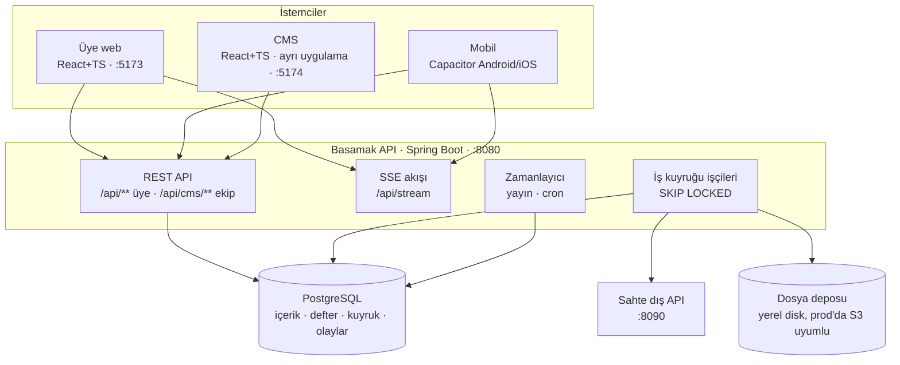

# Basamak — Tasarım Belgesi

> Durum: **canlı belge.** Her geliştirme fazında, o fazda gerçekten alınan kararlarla güncellenir.
> Bir bölümün yanında *(taslak)* yazıyorsa karar verilmiş ama henüz kodda doğrulanmamıştır.
> Kodda doğrulanmış kararlar ilgili test sınıfına bağlantı verir.

## İçindekiler
1. Kapsam, varsayımlar ve yapmadıklarımız
2. Mimari (C4 bağlam ve kap)
3. Veri modeli ve sürümleme
4. Araç ve iş akışı çalıştırma motoru
5. Oyunlaştırma ve puan defteri
6. API sözleşmesi
7. Yetki, güvenlik (OWASP eşlemesi) ve KVKK
8. Mobil: çevrimdışı eşitleme, bildirim, derin bağlantı
9. Ölçeklenme, izleme ve hata yönetimi
10. Mimari karar kayıtları (ADR)
11. İleriye bırakılanlar
12. "Sizin kararınız" — karar listesi
13. Yapay zekâ kullanımı

---

## 1. Kapsam, varsayımlar ve yapmadıklarımız

**Bağlam.** Ödevin normal süresi 10 gün, fiilî teslim süresi ise yaklaşık 21 saat (23.11.2026 14.16 → 24.11.2026 12.00). Kapsam bu süreye göre önceliklendirildi:
P0 çalışan uçtan uca akış → P1 zorunlu senaryoların iş kuralları ve testleri → P2 mobil ve kalan senaryolar → P3 kalite ve ölçüm.
Hangi senaryonun hangi durumda olduğu her zaman `README.md` ve `DURUM.md` içinde dürüstçe yazılıdır.

**Varsayımlar**
- **Sıfır ek maliyet.** Ücretli servis kullanılmaz. Yapay zekâ sağlayıcısı varsayılan olarak `mock`; isteğe bağlı olarak yerel Ollama (ücretsiz) seçilebilir. E-posta Mailpit'e, araçlar kendi yazdığımız sahte servise gider.
- **Tek bölge ve tek veritabanı.** İlk yıl ölçeği (50.000 üye, 2.000 eşzamanlı kullanıcı, günde 20.000 çalıştırma) tek bir PostgreSQL birincil sunucusu ve yatay ölçeklenen, durumsuz uygulama düğümleriyle karşılanabilir (bkz. §9).
- Bütün zamanlar veritabanında UTC olarak saklanır. Gün sınırı (seri, günlük kota, haftalık sıralama) ve zamanlanmış yayın **Europe/Istanbul** saatine göre hesaplanır.
- **Journey seviyesi.** Üyenin seviyesi, açık olan ve henüz bitirmediği en düşük sıralı Journey'dir. Hiçbirini bitirmemişse Beginner'dır.

**Yapmadıklarımız** (gerekçe ve alternatifler için bkz. §11)
- iOS derlemesi ve simülatör testi: Windows makinede yapılamaz. Yapılandırma ve talimat hazırdır ama **test edilmemiştir**. APNs, ücretli Apple Developer hesabı gerektirir.
- Bölüm 3.11 (arama, çok dillilik, kurumsal alanlar): PDF'e göre kodda seçmeli; yalnız tasarımı yapıldı.
- Topluluk özelliklerinin (takip, akış, yorum, moderasyon) arayüzleri ertelendi. Zorunlu senaryolarda yer almıyorlar; tasarım kararları §12'de.

## 2. Mimari

**Modüler monolit** yaklaşımı (gerekçesi ADR-1'de): Tek bir Spring Boot dağıtım birimi var. İçindeki modüller paket sınırlarıyla ayrılır ve birbirlerine yalnız servis arayüzleri üzerinden erişir. Arka plan işçileri aynı ikili dosyada çalışır; işçi sayısı ayarla ölçeklenir ve ayrı bir süreç olarak da başlatılabilir.

### C4 — Bağlam

### C4 — Kaplar

**Modüller:** `auth`, `content` (sürüm ve yayın), `journey`, `learning` (kayıt, ilerleme, quiz, anket), `gamification` (kural, defter, rozet, sıralama), `tool`, `workflow`, `community` (paylaşım ve çatallama), `notification` (SSE, e-posta, push), `report`, `privacy` (dışa aktarma ve silme), `common`.

## 3. Veri modeli ve sürümleme *(taslak — F1'de kesinleşecek)*
- `content_item`: Kararlı kimlik, tür, sahip, `lock_version`, `published_version_id`.
- `content_version`: Sürüm numarası, durum, **JSONB tam kopya**, yazar, editör notu, `scheduled_at`, `published_at`.
- **Eğitim bir aggregate'tir.** Ders, quiz ve anket, eğitim sürümünün içinde kararlı `itemKey` anahtarlarıyla tutulur. Araçlara `(toolId, versionNo)` ile **sabitlenmiş** referans verilir.

## 4. Araç ve iş akışı çalıştırma motoru *(F3–F4'te yazılacak)*

## 5. Oyunlaştırma ve puan defteri *(F2'de yazılacak)*

## 6. API sözleşmesi
OpenAPI dosyası springdoc ile üretilir ve `docs/openapi.yaml` olarak depoya eklenir.

## 7. Yetki, güvenlik ve KVKK *(F1'de yazılacak)*

## 8. Mobil *(F2.5 ve F6'da yazılacak)*

## 9. Ölçeklenme, izleme ve hata yönetimi *(F7'de ölçümlerle yazılacak)*

## 10. Mimari karar kayıtları (ADR)

### ADR-1 — Modüler monolit
- **Bağlam:** Dört istemci yüzeyi ve çok sayıda alan var. Ekip tek kişi, süre çok kısa. İçerik, defter ve iş akışı arasında **işlemsel tutarlılık** gerekiyor; örneğin eğitim tamamlanınca ilerleme ve puan aynı işlemde yazılmalı.
- **Seçenekler:** (a) Mikroservisler. (b) Modüler monolit. (c) Katmanlı ama modülsüz monolit.
- **Karar:** (b). Modüller paket sınırlarıyla ayrılır; puan defteri gibi kritik yazımlar tek bir veritabanı işleminde yapılır.
- **Sonuçlar:** Dağıtık işlem ya da saga gerekmez ve yerelde tek komutla ayağa kalkar. İleride işçiler ve SSE ayrı süreçlere çıkarılabilir, çünkü kuyruk zaten veritabanında. Bunun bedeli, modül sınırlarının disiplinle korunması gerekmesidir.

### ADR-2 — İş kuyruğu PostgreSQL üzerinde (`FOR UPDATE SKIP LOCKED`)
- **Bağlam:** Araç ve iş akışı çalıştırmaları dakikalarca sürebilir. Tekrar deneme, zaman aşımı, iptal ve sunucu yeniden başlarken iş kaybetmeme gerekiyor. Ölçek günde 20.000, kampanya günlerinde 200.000 çalıştırma; bu, saniyede ortalama yaklaşık 2,3 iş demek.
- **Seçenekler:** (a) Redis ve BullMQ (Node'a özgü). (b) RabbitMQ veya Kafka. (c) Temporal. (d) Postgres tablosu ve `SKIP LOCKED`.
- **Karar:** (d).
  - İş kaydı, iş verisiyle **aynı işlemde** yazılır (transactional outbox'a gerek kalmaz).
  - Kilit süresi (`locked_until`) dolan işi başka bir işçi devralır; böylece sunucu yeniden başladığında iş kaybolmaz.
  - `idempotency_key` UNIQUE kısıtı aynı işin iki kez kuyruğa girmesini önler.
  - Ek altyapı gerekmez ve sıfır maliyet kuralına uyar.
- **Sonuçlar:** Saniyede birkaç yüz işe kadar rahattır. Daha yüksek hacimde (§9) kuyruk tablosu bölümlenir ya da işler adanmış bir aracıya taşınır. Kuyruğa erişim `JobQueue` arayüzünün arkasındadır.

## 11. İleriye bırakılanlar *(her fazda güncellenir)*

## 12. "Sizin kararınız" — karar listesi
Her soru, cevaplandığı bölüme bağlanacak. Henüz cevaplanmamış sorular ☐, cevaplanmış olanlar ☑ ile işaretlidir.

**3.1 Üyelik ve yetki**
- ☐ Web ve mobil için oturum ve jeton yapısı
- ☐ Yetki modeli: rol tabanlı mı, nesne düzeyinde mi (yazar yalnız kendi taslağını mı düzenler)?
- ☐ Kaba kuvvet koruması ve hesap kilitleme

**3.2 Journey**
- ☐ Journey'i bitirmiş üyeler varken yeni eğitim eklenirse seviyeleri ne olur?
- ☐ Ön koşul döngüsü nasıl engellenir?
- ☐ Puan ile seviye arasındaki ilişki; seviye düşebilir mi?
- ☐ Journey yayından çekilirse kazanılmış sertifika ve puanlar ne olur?

**3.3 Eğitim ve içerik**
- ☐ Açık uçlu cevapları kim değerlendirir; üyenin itiraz yolu ne?
- ☐ Quiz süresi dolarken bağlantı koparsa ne olur?
- ☐ Videolar nasıl saklanır ve oynatılır (HLS)?
- ☐ Anonim anket gerçekten anonim mi?

**3.4 Sürüm ve yayın**
- ☐ Sürümleme modeli: tam kopya, değişiklik kaydı ya da olay kaynaklı?
- ☐ İç içe içerikte sürüm bağlama; quiz'in yeni sürümü eğitimi kendiliğinden günceller mi?
- ☐ Eğitimin ortasındayken yeni sürüm yayınlanırsa ne olur; ilerleme nasıl taşınır?
- ☐ Yanlış yayın geri alınınca arada verilen cevaplar ve kazanılan puanlar ne olur?
- ☐ Medya sürümleme ve saklama maliyeti

**3.5 Araçlar**
- ☐ Kuyruk ve işçi mimarisi (ADR-2) · ☐ Aynı işin iki kez çalışmasının önlenmesi
- ☐ Dış API yavaşlar ya da çökerse koruma (devre kesici, eşzamanlılık sınırı)
- ☐ Çıktıların saklanma süresi · ☐ Kötü niyetli araçların tespiti · ☐ Şablon enjeksiyonu

**3.6 İş akışları**
- ☐ Akış modeli ve çalıştırma motoru (kendi motorumuz mu, hazır bir araç mı?)
- ☐ Çalışma sırasında aracın ya da alt akışın yeni sürümü yayınlanırsa ne olur?
- ☐ İstem enjeksiyonu · ☐ Büyük çıktı · ☐ Sunucu yeniden başlarsa ne olur? · ☐ Aynı webhook iki kez gelirse?
- ☐ Çatallanan akışın özgün sahibi akışını silerse ne olur?

**3.7 Oyunlaştırma**
- ☐ Puan tablosu ve gerekçesi · ☐ Kural değişince geçmiş puanlar yeniden hesaplanır mı?
- ☐ Silinen araç ya da geri alınan yayın için puan geri alınır mı?
- ☐ 50.000 üyede sıralama tablosu · ☐ Çevrimdışı aksiyon puanı ve cihaz saatiyle oynanması

**3.8 Topluluk**
- ☐ Yorumlarda kişisel veri ve küfür süzme · ☐ Paylaşılan araç kimin kotasından düşer, kimin anahtarını kullanır? · ☐ Etkinlik akışının ölçeklenmesi

**3.9 Bildirimler**
- ☐ WebSocket mi, SSE mi? · ☐ Kaçırılan olaylar · ☐ Bildirimin iki kez gitmemesi · ☐ Sessiz saatler

**3.10 Geçmişim ve KVKK**
- ☐ Olay kaydının yapısı ve saklama süresi · ☐ Silinen hesabın paylaştıkları, yorumları ve sıralamadaki yeri · ☐ Sertifika sahteciliği

**3.11 Arama ve kurumsal kullanım**
- ☐ Arama altyapısı · ☐ Eksik çeviri · ☐ Çok kiracılı veri ayrımı ve maliyeti

**3.12 Raporlar**
- ☐ Canlı veritabanı mı, analitik depo mu? · ☐ Kabul edilebilir gecikme

**Bizim bulduğumuz ek kararlar**
- ☐ Yayınlanmamış içeriğin sızmasını önleyen katman
- ☐ CMS ile üye uygulamasının origin ayrımı ve CORS
- ☐ Zamanlanmış yayının saat dilimi ve kaçırılan tetikleme
- ☐ Mobil eşitlemede olay kimliğini istemci mi üretir?

## 13. Yapay zekâ kullanımı *(sürekli güncellenir)*
- **Araç:** Claude Code (Anthropic).
- **Kullanım alanları:** PDF analizi ve gereksinim matrisi, mimari plan taslağı, iskelet kod ve test üretimi, belge taslakları.
- **Doğrulama:** Her faz derleme ve otomatik testlerle doğrulanır. Komutlar ve gerçek sonuçları `DURUM.md`'de kayıtlıdır. Kararların sahibi geliştiricidir; reddedilen ve değiştirilen öneriler burada listelenir.
