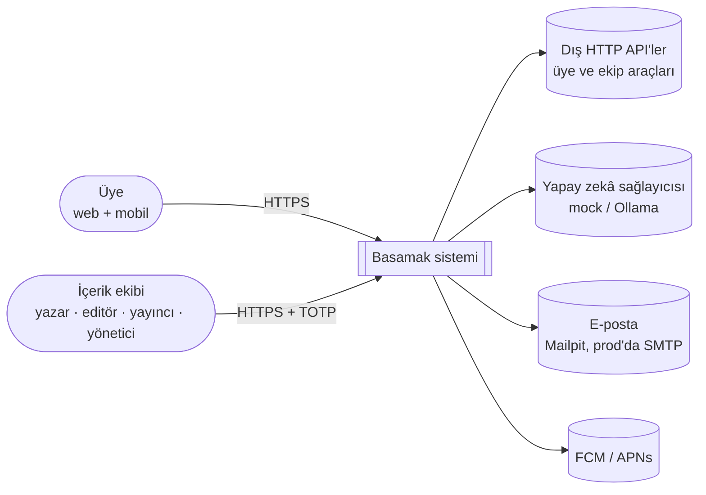
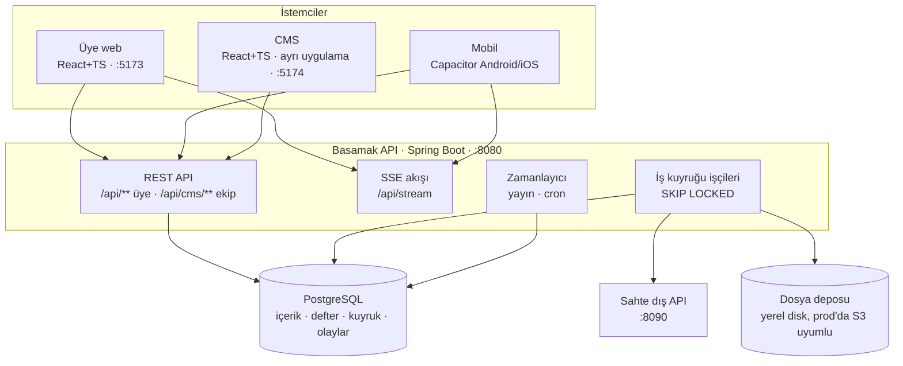
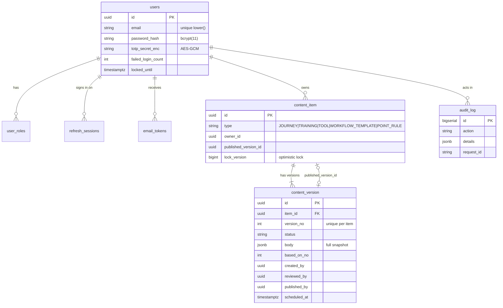
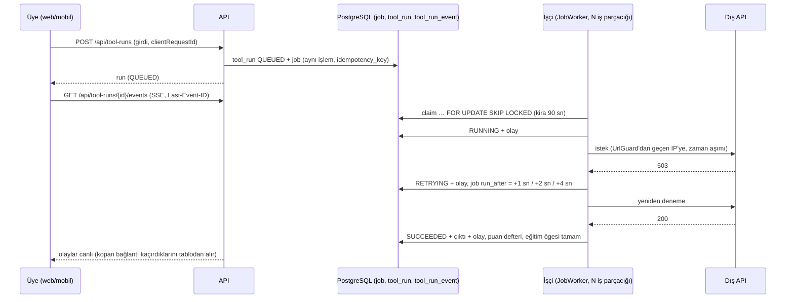
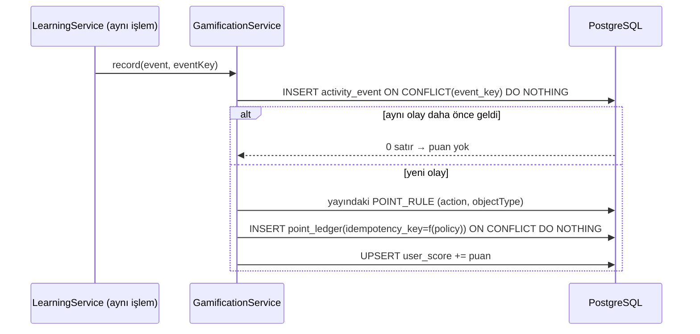

# Basamak — Tasarım Belgesi

> Durum: **canlı belge.** Her geliştirme fazında, o fazda gerçekten alınan kararlarla güncellenir.
> Bir bölümün yanında *(taslak)* yazıyorsa karar verilmiş ama henüz kodda doğrulanmamıştır.
> Kodda doğrulanmış kararlar ilgili test sınıfına bağlantı verir.

## İçindekiler
1. Kapsam, varsayımlar ve yapmadıklarımız
2. Mimari (C4 bağlam ve kap)
3. Veri modeli ve sürümleme
4. Araç ve iş akışı çalıştırma motoru
5. Oyunlaştırma ve puan defteri
6. API sözleşmesi
7. Yetki, güvenlik (OWASP eşlemesi) ve KVKK
8. Mobil: çevrimdışı eşitleme, bildirim, derin bağlantı
9. Ölçeklenme, izleme ve hata yönetimi
10. Mimari karar kayıtları (ADR)
11. İleriye bırakılanlar
12. "Sizin kararınız" — karar listesi
13. Yapay zekâ kullanımı

---

## 1. Kapsam, varsayımlar ve yapmadıklarımız

**Bağlam.** Ödevin normal süresi 10 gün, fiilî teslim süresi ise yaklaşık 21 saat (23.11.2026 14.16 → 24.11.2026 12.00). Kapsam bu süreye göre önceliklendirildi:
P0 çalışan uçtan uca akış → P1 zorunlu senaryoların iş kuralları ve testleri → P2 mobil ve kalan senaryolar → P3 kalite ve ölçüm.
Hangi senaryonun hangi durumda olduğu her zaman `README.md` ve `DURUM.md` içinde dürüstçe yazılıdır.

**Varsayımlar**
- **Sıfır ek maliyet.** Ücretli servis kullanılmaz. Yapay zekâ sağlayıcısı varsayılan olarak `mock`; isteğe bağlı olarak yerel Ollama (ücretsiz) seçilebilir. E-posta Mailpit'e, araçlar kendi yazdığımız sahte servise gider.
- **Tek bölge ve tek veritabanı.** İlk yıl ölçeği (50.000 üye, 2.000 eşzamanlı kullanıcı, günde 20.000 çalıştırma) tek bir PostgreSQL birincil sunucusu ve yatay ölçeklenen, durumsuz uygulama düğümleriyle karşılanabilir (bkz. §9).
- Bütün zamanlar veritabanında UTC olarak saklanır. Gün sınırı (seri, günlük kota, haftalık sıralama) ve zamanlanmış yayın **Europe/Istanbul** saatine göre hesaplanır.
- **Journey seviyesi.** Üyenin seviyesi, açık olan ve henüz bitirmediği en düşük sıralı Journey'dir. Hiçbirini bitirmemişse Beginner'dır.

**Yapmadıklarımız** (gerekçe ve alternatifler için bkz. §11)
- iOS: Windows'ta derlenemez. GitHub'ın ücretsiz macOS makinesinde simülatör için derlenip açıldı (§8.3); giriş yapılmış tam tur ve gerçek cihaz **denenmedi**. APNs, ücretli Apple Developer hesabı gerektirir.
- Bölüm 3.11 (arama, çok dillilik, kurumsal alanlar): PDF'e göre kodda seçmeli; yalnız tasarımı yapıldı.
- Topluluk özelliklerinin (takip, akış, yorum, moderasyon) arayüzleri ertelendi. Zorunlu senaryolarda yer almıyorlar; tasarım kararları §12'de.

## 2. Mimari

**Modüler monolit** yaklaşımı (gerekçesi ADR-1'de): Tek bir Spring Boot dağıtım birimi var. İçindeki modüller paket sınırlarıyla ayrılır ve birbirlerine yalnız servis arayüzleri üzerinden erişir. Arka plan işçileri aynı ikili dosyada çalışır; işçi sayısı ayarla ölçeklenir ve ayrı bir süreç olarak da başlatılabilir.

### C4 — Bağlam

### C4 — Kaplar

**Modüller:** `auth`, `content` (sürüm ve yayın), `journey`, `learning` (kayıt, ilerleme, quiz, anket), `gamification` (kural, defter, rozet, sıralama), `tool`, `workflow`, `community` (paylaşım ve çatallama), `notification` (SSE, e-posta, push), `report`, `privacy` (dışa aktarma ve silme), `common`.

## 3. Veri modeli ve sürümleme

### 3.1 Varlık–ilişki (F1 itibarıyla kodda olanlar)

### 3.2 Sürümleme modeli: tam kopya (ADR-3)
- Her kayıt yeni bir `content_version` satırı açar. Gövde, içeriğin **tam JSONB kopyasıdır**. Eski satırlar silinmez ve güncellenmez; yalnız durum alanı ilerler.
- `content_item.published_version_id`, üyeye gösterilecek tek sürümü işaret eder. Yayın ve geri alma yalnız bu işaretçiyi değiştirir, bu yüzden atomiktir.
- **Durum makinesi:**
  `DRAFT → IN_REVIEW → APPROVED → (SCHEDULED →) PUBLISHED → ARCHIVED`.
  `IN_REVIEW → CHANGES_REQUESTED` (gerekçe zorunlu); yazar yeniden kaydedince yeni bir `DRAFT` açılır.
  Gönderilmeden üzerine yeni kayıt yapılan taslaklar `SUPERSEDED` olur ama geçmişte görünmeye devam eder.
- **Geri alma:** `ARCHIVED` (bir kez yayınlanmış) bir sürüm, yeni bir onay gerekmeden yeniden yayınlanabilir; o kopya zaten onaylanmıştı. Bu işlem `content.republished` olarak audit'e düşer.
- **Fark görünümü:** İki kopya arasında yapısal JSON farkı alınır (`JsonDiff`). Çıktı `path`, `op` (added / removed / changed) ve önceki/sonraki değerden oluşur.
- **Zamanlanmış yayın:** Saat CMS'te Europe/Istanbul olarak girilir ve UTC `Instant` olarak saklanır. `ScheduledPublisher` 15 saniyede bir `scheduled_at <= now` olan sürümleri `FOR UPDATE SKIP LOCKED` ile alır. Birden çok düğüm aynı sürümü iki kez yayınlayamaz. Sunucu kapalıyken kaçırılan yayınlar ilk çalışmada yetişir.
- **Yayınlanmamış içerik sızıntısı:** Üye tarafı içeriğe yalnız `PublishedContent` servisinden erişir. Bu servis yalnız `published_version_id` işaretçisi üzerinden sorgu yapar; taslak okuyan bir üye API'si yoktur. `ContentWorkflowIT.scenario1` bunu liste ve id üzerinden doğrular (taslak için 404).

### 3.3 İç içe içerik ve sürüm sabitleme
- **Eğitim bir aggregate'tir.** Ders, quiz, anket ve soru bankası, eğitim sürümünün içinde kararlı `itemKey` anahtarlarıyla tutulur. Böylece eğitimin bir sürümü, içerdiği her şeyin tutarlı bir kopyasıdır. Quiz'i ayrı yayınlayıp eğitimi kendiliğinden değiştirmek yoktur; quiz değişirse eğitimin yeni sürümü yayınlanır.
- **Araçlar** kendi sürümleri olan bağımsız içeriklerdir. Eğitim bir araca `(toolId, versionNo)` ile **sabitlenmiş** referans verir. Aracın yeni sürümü eğitimi sessizce değiştirmez; editör eğitimin yeni sürümünde sabitlemeyi yükseltir.
- **Journey** eğitimlere item id ile bağlanır (sabitlenmemiş). Journey her zaman eğitimin son yayınlanan sürümünü gösterir, çünkü Journey "hangi eğitimler" sorusunun cevabıdır, içeriğin kendisi değildir.

### 3.4 Eşzamanlı düzenleme (senaryo 4)
- Editör içeriği açtığında `lockVersion` değerini alır ve kaydederken bu değeri geri gönderir. Değer güncel değilse **409 `edit_conflict`** döner; cevapta son sürüm numarası ve onu kaydeden kişi yer alır. CMS çakışma ekranı bu bilgiyle "güncel sürümü yükle ve değişikliğini yeniden uygula" seçeneğini sunar.
- Kontrol ile yazma arasındaki yarış durumunu JPA `@Version` kapatır (`UPDATE … WHERE lock_version = ?`). Ayrıca `(item_id, version_no)` UNIQUE kısıtı ikinci bir güvencedir.
- **Kanıt:** `ContentWorkflowIT.scenario4_trulyConcurrentSavesExactlyOneWins`, iki iş parçacığını aynı anda kaydettirir. Sonuç tam olarak bir 200 ve bir 409; geçmişte yalnız bir yeni sürüm oluşuyor.
- **Öge anahtarlarının sabitliği:** Eğitim ögesinin `key` alanı; ilerleme, defterdeki tek seferlik puan anahtarı (`eğitim:anahtar`) ve quiz denemeleri için kimlik görevi görür. Yayınlanmış bir anahtarın değişmesi iki zarar doğurur: ilerleme yeni sürüme taşınmaz ve öge yeniden tamamlanınca **tekrar puan** verilir.
  - **Kural:** Daha önce yayınlanmış bir anahtar sıradan bir kayıtla kaybolamaz (yeniden adlandırma ya da silme). Sunucu 409 `published_keys_removed` döndürür.
  - **Bilerek kaldırma:** Ancak açık onayla (`confirmRemovedKeys`) yapılır.
  - **CMS'te:** Yayınlanmış anahtar alanı salt okunurdur; yayınlanmış bir ögeyi silmek onay ister.
  - **Kanıt:** `JourneyPolicyIT.publishedItemKeysCannotSilentlyDisappear`.
- **Neden kilitleme yok, gerçek zamanlı ortak düzenleme yok:** Düşük çakışma oranında (20 kişilik ekip) iyimser kilit basittir ve veri kaybını önler. Ortak düzenleme (CRDT) bu kapsam için fazla karmaşık; §11'de ertelenenler arasında.

### 3.5 Medya: görsel, video ve dosya ekleri (3.3, 3.4)
- **Yükleme:** Yalnız içerik ekibi yükler (`POST /api/cms/media`). Tür, dosyanın **ilk baytlarından** belirlenir; istemcinin bildirdiği tür ve dosya adı dikkate alınmaz. SVG ve HTML kabul edilmez (görselin içinde betik). Sınırlar: görsel 5 MB, dosya 20 MB, video 100 MB.
- **Sürümleme ve saklama maliyeti:** Dosyalar değişmezdir ve SHA-256 ile adreslenir; aynı dosya ikinci kez yüklense de diskte bir kez durur. Ders sürümü dosyaya kimlikle başvurur (``, `video.mediaId`, `attachments`). Eski sürümler kendi dosyalarını göstermeye devam eder; hiçbir şeyin üstüne yazılmaz. Hiçbir sürümün başvurmadığı dosyaları silen bir temizlik işi henüz yok (§11).
- **Erişim:** Üye bir dosyayı yalnız **yayındaki** bir sürüm ona başvururken okuyabilir; taslak medya hiçbir yoldan görünmez. CMS önizlemesi bir saatlik HMAC imzalı adres kullanır (`` bearer jeton gönderemez). Cevaplarda `nosniff` ve `sandbox` CSP vardır. Video için HTTP Range desteklenir (ileri sarma).
- **Erişilebilirlik:** Görselin alt metni zorunludur; kaydetmede denetlenir.
- **Videolar (Sizin kararınız):** Bugün tek dosya MP4/WebM olarak saklanır ve tarayıcının oynatıcısıyla Range isteğiyle oynatılır. 2 TB ölçeğinde: yüklenen video bir iş olarak HLS'ye (ör. 360p/720p/1080p) dönüştürülür, parçalar nesne depolamada (S3 uyumlu) ve CDN arkasında tutulur, imzalı ve kısa ömürlü adreslerle dağıtılır. İzleme süresi bugünkü gibi sunucuda, duvar saatiyle sınırlanarak ölçülür; ileri sarmak süreyi artırmaz.
- **Mobilde:** "Çevrimdışı için indir" eğitimin metnini, görsellerini ve eklerini cihaza (Cache Storage) kaydeder; videolar boyut nedeniyle indirilmez.

## 4. Araç ve iş akışı çalıştırma motoru

### 4.1 Araç modeli
- **CMS aracı:** Sürümlü bir içeriktir (`TOOL`) ve taslak → inceleme → onay → yayın akışından geçer. Gövdesi `ToolDefinition`'dır: girdiler, yöntem, URL, başlıklar, JSON gövde şablonu, zaman aşımı (1–30 sn), yeniden deneme (0–3) ve sonuç alanı. Eğitim aracı `(toolId, versionNo)` ile **sabitler**. Yayın sırasında sabitlenen sürümün yayınlanmış olması zorunludur.
- **Üye aracı:** `user_tool` tablosunda tutulur. Her kayıt yeni bir sürüm satırı açar (`user_tool_version`), çalıştırma o sürüme bağlanır. Aynı üyenin aynı tanımı ikinci kez kaydetmesi reddedilir (`def_hash`); boş ya da kopya araçla puan toplanamaz.
- **Sırlar:** `tool_secret` tablosunda AES-256-GCM ile şifreli tutulur. Sürüm kopyasına, farka, denetim kaydına ve API cevaplarına girmez; yalnız adı ve son güncelleme zamanı döner. Değer, işçi isteği gönderirken çözülür. Önizlemede ve hata mesajlarında `••••` görünür.
- **Şablonlar enjeksiyona kapalıdır:**
  - Değerler yerleştirilir, hiçbir zaman değerlendirilmez.
  - URL'de yüzde kodlanır ve yalnız yol ile sorguda kullanılabilir; sunucu adı kaydedilirken sabittir.
  - Başlıklarda CR ve LF silinir.
  - JSON gövde metin birleştirmeyle değil Jackson ağacıyla üretilir.
  - Sırlar gövdede kullanılamaz.
- **OAuth 2.0 istemci kimliği (client credentials):** Tanımda `auth.tokenUrl` (ve isteğe bağlı `scope`) verilir; istemci kimliği ve sırrı `clientId` ve `clientSecret` adlı şifreli sırlardır. İşçi jetonu jeton adresinden alır (aynı SSRF kuralları), süresi bitene kadar **yalnız bellekte** tutar ve `Authorization: Bearer` olarak gönderir. 401 gelirse jeton atılır, sonraki denemede yenisi alınır. Jeton hiçbir ekrana, kayda ya da API cevabına girmez (test edildi).
- **Dosya çıktısı (50 MB):** JSON ya da metin olmayan cevaplar (PDF, görsel, ZIP…) belleğe alınmaz, diske akıtılır; 50 MB'ı aşarsa kesilir. Çalıştırma yalnız dosyanın adını, türünü ve boyutunu saklar. Dosya **7 gün** tutulur (saatlik temizlik işi), yalnız çalıştırmanın sahibi indirir.
- **Şemayı bozan sürüm:** Yeni sürümde bir girdi kaldırılırsa, türü değişirse, yeni zorunlu girdi eklenirse ya da çıktı seçimi değişirse bu "bozucu değişiklik" olarak işaretlenir (`ToolCompat`). Üyeye kaydederken, CMS'te yayındaki sürümle karşılaştırılarak gösterilir. Eğitimler ve iş akışları sürüme sabitli olduğu için hiçbiri kendiliğinden bozulmaz.
- **Günlük kota (seviyeyle artar):** Üye başına günlük araç çalıştırma hakkı Beginner'da 20, Expert'te 40, Master'da 60'tır (`TOOLS_DAILY_RUNS_PER_LEVEL`). Gün İstanbul saatiyle yenilenir. Ayrıca IP başına dakikada 30 çalıştırma başlatma sınırı vardır.
- **Paylaşılan araç (Sizin kararınız: kimin kotası, kimin anahtarı):** Üye aracını toplulukla paylaşabilir; paylaşılan şey yalnız **tanımdır**. Başka üye aracı kendi listesine kopyalar (çatal) ve kendi anahtarını ekler. Çalıştırma, çalıştıranın kotasından düşer ve çalıştıranın anahtarını kullanır; kimse başkasının anahtarını ya da kotasını harcayamaz. Platform araçlarında anahtar ve maliyet platformundur.
- **Kötü niyetli araç (Sizin kararınız):** İç ağa erişim UrlGuard ile kesin olarak engellenir. Başka sitelere saldırıya karşı: üye kotası, eşzamanlı 5 çalıştırma, IP başına hız sınırı ve 30 sn süre sınırı. İzleme (§9): hedef alan adı başına hata oranı ve hacim; eşik aşılınca araç ve sahibi otomatik askıya alınır, moderatöre düşer. Bu otomatik askıya alma **yapılmadı** (§11).

### 4.2 Çalıştırma (sıra şeması)

- **Yeniden denenir:** Zaman aşımı, bağlantı hatası, 408, 425, 429 ve 5xx. **Denenmez:** Diğer 4xx, engellenen adres, eksik sır ve 1 MB'ı aşan cevap.
- **İptal:** Kuyrukta bekleyen iş hemen kuyruktan alınır. Çalışan iş, canlı HTTP isteği iptal edilerek durdurulur; işçi CANCELLED yazar.
- **Sunucu yeniden başlarsa:** Kirası dolan işi başka bir işçi alır. Deneme hakkı bitmişse sonuç FAILED yazılır; iş sessizce kaybolmaz.
- **Aynı iş iki kez çalışmaz:**
  - Kuyrukta `idempotency_key` UNIQUE kısıtı vardır.
  - Çift tıklamada aynı `clientRequestId` aynı çalıştırmayı döndürür.
  - Bir işi aynı anda iki işçi alamaz (`SKIP LOCKED`, `ToolIT.queue_*`).
- **Dış API yavaşlarsa ya da çökerse:** En fazla `JOB_WORKERS` iş parçacığı bağlanır ve API'nin istek iş parçacıkları etkilenmez. Üye başına en çok 5 eşzamanlı çalıştırma vardır. Her denemenin bir süre sınırı vardır. Devre kesici (art arda hata veren hedefi bir süre atlamak) **yapılmadı**; §11'de.
- **Çıktı:** 1 MB sınırı vardır. JSON değilse en fazla 10 KB metin saklanır. Saklama süresi önerisi 90 gündür (KVKK, F5); temizleme işi henüz yok.

### 4.3 SSRF koruması (senaryo 7) — `UrlGuard`
1. Yalnız http ve https kabul edilir; kullanıcı bilgisi içeren URL reddedilir. Sunucu adı şablonla oluşturulamaz.
2. `localhost`, `*.local`, `*.internal` ve metadata adları DNS'e sorulmadan reddedilir.
3. Ad çözülür ve dönen **her adres** denetlenir: loopback, 0/8, 10/8, 172.16/12, 192.168/16, 100.64/10, 169.254/16 (metadata dahil), 198.18/15, multicast ve ayrılmış aralıklar, IPv6 loopback, ULA ve link-local. IPv6 içine gömülü IPv4 de denetlenir (`::ffff:`, NAT64, 6to4). `2130706433`, `127.1` ve `::ffff:127.0.0.1` gibi yazımlar aynı adrese çözüldüğü için aynı kontrolde yakalanır.
4. **DNS rebinding:** HTTP istemcisinin `DnsResolver`'ı aynı denetimi yapar, bağlantı yalnız denetimden geçen adreslere açılır. Kaydederken herkese açık olan ama sonra iç ağı gösteren bir ad, çalıştırma anında reddedilir (test edildi).
5. **Yönlendirme:** Otomatik takip kapalıdır. En fazla 3 yönlendirme elle izlenir ve her adım 1–4'ten yeniden geçer. Başka bir sunucuya yönlendirmede sırlı başlıklar gönderilmez.
6. Proxy, çerez ve otomatik yeniden deneme kapalıdır.
7. **İstisna:** `TOOLS_TRUSTED_HOSTS` (varsayılan `localhost:8090`, yani sahte API) **yalnız CMS araçları** için ve **yalnız bu host:port** için açıktır. Üye araçları hiçbir koşulda iç ağa gidemez. Prod'da bu liste boş bırakılır.

### 4.4 Sahte dış API (`mock-api/MockApi.java`)
Yalnız JDK ile çalışan tek bir dosyadır (`java mock-api/MockApi.java`, :8090). Sağladıkları:
- **Öğrenme araçları** (tohum verisindeki üç platform aracının arkası; kurala dayalıdır, gerçek bir dil modeli değildir):
  - `POST /text/summarize`: Metnin ilk cümlelerinden özet, kelime sayısı ve okuma süresi ("Metin özetleyici").
  - `GET /glossary?term=`: Otomasyon ve platform terimleri için kısa Türkçe açıklama ("Terim sözlüğü").
  - `POST /text/check`: `X-Api-Key` ister; uzun cümle, tekrar ve noktalama önerileri ve bir puan döner ("Metin denetleyici"; sır akışını gösterir).
- **Gösterim yardımcıları:**
- `/weather`: `X-Api-Key` başlığı ister (eski örnek).
- `/slow?ms=`: Zaman aşımını göstermek için gecikmeli cevap verir.
- `/flaky?key=&fail=`: İlk N çağrıda 503 döner, sonra başarılı olur (yeniden denemeyi gösterir).
- `/status/{code}`: İstenen HTTP kodunu döner.
- `/redirect?to=`: Yönlendirme engelini gösterir.
- `/echo`: Gönderilen gövdeyi geri döner.

Ücretli hiçbir servise gidilmez.

### 4.4a Araç ve akış kurma deneyimi (adım adım)
Araç ve iş akışı oluşturmak yeni başlayan üye için karmaşıktır; her şey tek ekranda olunca kaybolur. Bu yüzden ikisi de **adım adım sihirbazdır** (ortak `Wizard` bileşeni; web ve CMS):
- **Araç (4 adım):** Ne yapacak? (hazır şablon: Vikipedi konu özeti, İngilizce sözlük ya da boş) → Kullanıcıdan ne istenecek? (etiketten teknik ad otomatik) → Nereye bağlanacak? (alanları adrese tek tıkla ekleme, kimlik doğrulama: yok / API anahtarı / CMS'te OAuth) → Özet ve kaydet. Zaman aşımı, yeniden deneme, başlıklar ve gövde "Gelişmiş" altında katlıdır. Kaydedince araç hemen denenebilir hâlde açılır. Üye şablonları herkese açık ücretsiz servisleri kullanır, çünkü üye araçları güvenlik gereği yerel sahte servise erişemez.
- **İş akışı (4 adım):** Ad ve amaç (şablon: "Ders notundan tekrar soruları", "Haftalık çalışma planı", "Terimi açıkla" ya da boş) → Girdiler → Adımlar → Sonuç ve kaydet.
  - Adımlar listesinde **aynı anda tek adım düzenlenir**; diğerleri tek satırlık özet kartıdır. "Adım ekle" önce açıklamalı tür seçimi gösterir.
  - Değer bağlamak için `{{…}}` yazmak gerekmez: açılır listeden "Girdi: Konu" ya da "ozet (Metin özetleyici) → özet" seçilir. Birkaç değeri birleştiren ileri kullanıcı için "elle yaz" seçeneği kalır.
  - Paralel çalışma ve adım kimliği "Gelişmiş" altındadır. Canlı akış şeması adımlar sayfasının üstündedir.
- **Akış sayfası sekmelere ayrılır:** Kurgu, Çalıştır, Geçmiş, Ayarlar (zamanlama, webhook, olay, paylaşım, silme) ve paylaşılan akışlarda Tartışma. Yeni akış kaydedilince doğrudan "Çalıştır" sekmesi açılır.
- **Erişilebilirlik:** Adım değişince odak adım başlığına taşınır; adım listesi `aria-current="step"` taşır; seçim kartları gerçek radyo düğmeleridir (ok tuşları ve ekran okuyucu çalışır); dar ekranda yalnız şimdiki adımın adı görünür, diğerlerininki ekran okuyucuya okunur.

### 4.5 İş akışları (senaryo 8) — kendi motorumuz
- **Neden kendi motorumuz:** Temporal ya da Airflow ayrı bir altyapı ister; sıfır maliyet ve tek gün kısıtına uymaz. Akışlar kısa ve doğrusaldır (en fazla 20 adım), bu yüzden ADR-2'deki kuyrukta tek bir iş (`WORKFLOW_RUN`) olarak çalışır. İşçi her adımda kirasını uzatır (`heartbeat`).
- **Model:** Adımlar sırayla çalışır. Türler: `tool` (platform aracı sürümüyle ya da üye aracı kayıt anındaki sürümüyle **sabitlenir**), `ai`, `condition` ve `workflow` (alt akış). Koşul adımı yalnız kendisinden *sonraki* adımlara dallanır; seçilmeyen dal SKIPPED olur.
- **Eşleme:** Bir adım yalnız `{{input.x}}` ile girdiyi ve `{{steps.önceki.output.alan}}` ile *önceki* adımların çıktısını okuyabilir. Tek bir yer tutucudan oluşan değer JSON türünü korur. Bu kural, bir akışın içinde döngü kurulmasını yapısal olarak imkânsız kılar.
- **Dolaylı döngü:** Alt akışlar çağrıldıkları anda alt akışın *güncel* sürümünü kullanır. Kayıt sırasında bütün alt akış grafiği DFS ile taranır (A → B → C → A ve kendini çağırma reddedilir; hata mesajı döngünün yolunu adlarıyla gösterir). Çalışma anında ayrıca 5 seviyelik derinlik sınırı vardır.
- **Adım başına kayıt:** Her çalıştırma `workflow_step_run` tablosuna yazılır: girdi, çıktı, süre, token, maliyet, deneme sayısı ve alt akışın çalıştırma kimliği.
- **Hatalı adımdan devam:** Devam edildiğinde aynı çalıştırma yeniden kuyruğa girer. Başarılı adımların son çıktıları kullanılır ve hatalı adımdan itibaren çalışılır. Geçmiş korunur: hatalı satır kalır, üzerine yeni satır eklenir. Sunucu çökerse yarıda kalan adım FAILED olarak kapatılır ve kira dolunca çalıştırma kaldığı yerden sürer.
- **Çalışma sırasında aracın yeni sürümü yayınlanırsa:** Akış sabitlediği sürümü kullanmaya devam eder. Alt akışın yeni sürümü ise bir sonraki çağrıdan itibaren kullanılır. Hangi sürümün çalıştığı çalıştırma kaydında saklanır.
- **Yapay zekâ sağlayıcısı ayarla seçilir** (`AI_PROVIDER`): `mock` (varsayılan) ücretsiz ve deterministiktir; token sayısı tahmin, maliyet uydurma fiyat listesiyle hesaplanır ve arayüzde "benzetim" diye etiketlenir. `[fail]` işareti bilerek hata üretir. `ollama` ücretsiz yerel model sunucusu için yazıldı, **denenmedi** (makinede kurulu değil).
- **Paralel adımlar:** `parallel: true` işaretli araç ya da yapay zekâ adımı, önceki adımla aynı anda çalışır (sanal iş parçacıkları). Bir paralel grubun adımları birbirinin çıktısını okuyamaz (kayıtta reddedilir); sonraki bir adım hepsinin çıktısını birleştirebilir (`{{steps.a.output}} {{steps.b.output}}`). Grup içinde bir adım hata verirse çalıştırma o adımda durur, başarılı kardeşler devam etmede yeniden çalışmaz.
- **Kaydederken denetimler:** Aracın zorunlu girdisi eşlenmemişse ve tür uyuşmazlığı varsa (ör. sayı bekleyen girdiye yapay zekânın metin çıktısı) kayıt reddedilir. Türü bilinmeyen kaynaklar (araç çıktısı) çalışma anında araç girdisi doğrulamasından geçer.
- **Aylık yapay zekâ bütçesi:** Üye başına takvim ayı (İstanbul) bütçesi (`AI_MONTHLY_BUDGET_USD`, varsayılan 1 USD). Bütçe dolunca yapay zekâ adımı olan yeni çalıştırma 402 ile reddedilir. Çalışan akış, yapay zekâ adımına gelince **harcamadan önce** durur; adım nedeni yazan bir hatayla kapanır, önceki sonuçlar kalır ve ay yenilenince "devam et" ile sürer. Kullanım çalıştırma panelinde gösterilir.
- **Görsel kurucu:** Form tabanlı adım düzenleyicinin üstünde canlı bir akış şeması vardır: satırlar çalışma sırası, yan yana kutular paralel adımlar, düz oklar veri akışı, kesik oklar koşul dallarıdır. Şemanın metin karşılığı ekran okuyucuya verilir. Sürükle bırak düzenleme **yok**; adımlar formdan eklenir.
- **İstem enjeksiyonu:** Yapay zekâ çıktısı yalnız veridir. Sonraki adımın metnine ve koşula girebilir, ama araç, URL, sır ya da adım seçemez. Sırlar istemlere hiç girmez; URL'nin sunucu adı sabittir ve UrlGuard'dan geçer. En kötü durumda üretilen metin yanıltıcı olur.
- **Büyük çıktı:** JSON ya da metin cevabı 1 MB ile sınırlıdır; daha büyük dosyalar dosya çıktısı olur (§4.1). Bir adımın büyük çıktısı sonraki adımın istemine kırpılmadan girer; istem 8.000 karakteri aşarsa yapay zekâ adımı kaydedilemez. Prod'da çıktı nesne depolamaya yazılır ve adımlara yalnız başvurusu geçer.

### 4.6 Tetikleyiciler (senaryo 9)
- **Cron:** 5 alanlı, Europe/Istanbul saatiyle ve en sık dakikada bir. Zamanlayıcı 15 saniyede bir, vadesi gelen akışları `FOR UPDATE SKIP LOCKED` ile kilitler. İş anahtarı `cron:{akış}:{planlanan zaman}` olduğu için aynı tik iki kez ateşlense bile tek çalıştırma olur (test edildi).
- **Platform olayı:** Üye akışını kendi öğrenme olaylarından birine bağlar (ders, eğitim ya da Journey tamamlama, quiz geçme). Olay commit edildikten sonra akış başlar; iş anahtarı `event:{olay anahtarı}:{akış}` olduğu için aynı olay iki kez gelse (yeniden deneme, mobil eşitleme) tek çalıştırma olur (test edildi). Araç ve iş akışı olayları tetikleyici olamaz, böylece bir akış kendini döngüyle tetikleyemez. Olay alanları (eventType, objectType, objectId, occurredAt) aynı adlı girdilere geçer.
- **Webhook:** `POST /api/hooks/workflows/{token}`. Token rastgeledir, yalnız bir kez gösterilir ve SHA-256 özeti saklanır. `Idempotency-Key` başlığı (yoksa gövdenin özeti) iş anahtarına girer: aynı teslimat 200 ve aynı çalıştırma kimliğiyle cevaplanır, ilk teslimat 202 alır.

### 4.7 Paylaşım, çatallama ve sıralama (senaryo 11)
- **Paylaşılan akışın anahtarı:** Paylaşılan (PUBLIC) bir akış yalnız platform araçlarını kullanabilir (anahtar platformundur, kota platformdan düşer). Üyenin kendi aracını kullanan akış paylaşılamaz. Paylaşılan bir akışın alt akışları da paylaşılmış olmalıdır.
- **Çatallama:** Güncel tanım üyenin listesine kopyalanır (`forked_from`) ve `fork_count` artar. Yazar, her çatal için bir kez `SHARED_ITEM_FORKED` puanı kazanır. Kendi akışını çatallamak reddedilir. Başkası paylaşılan akışı alt akış olarak kullanırsa yazar günde bir kez `SHARED_ITEM_USED` puanı alır.
- **Özgün sahip akışını silerse:** Çatallar bağımsız kopya olduğu için çalışmaya devam eder. Silinen akışı alt akış olarak kullanan akış, çalıştırma anında açık bir hata mesajıyla durur.
- **Sıralama:**
  - Haftalık sıralama, defterden pazartesi 00.00'dan (İstanbul) bu yana yazılan puanlarla hesaplanır (`ix_point_ledger_created`). Genel sıralama `user_score`'dan okunur.
  - Canlı güncelleme için puan değişikliği commit edilince bir bayrak kalkar ve saniyede en fazla bir kez açık SSE akışlarına "changed" gönderilir. İstemci listeyi yeniden çeker.
  - Ölçek önerisi (§9): haftalık toplam için saatlik bir özet tablo ya da Redis sorted set.

## 5. Oyunlaştırma ve puan defteri

### 5.1 Puan tablosu (tohum verisi; CMS'ten değiştirilebilir)
| Aksiyon | Nesne | Puan | Tekrar politikası | Gerekçe |
|---|---|---:|---|---|
| `LESSON_VIEWED` | Ders | 1 | nesne başına bir kez | Görüntüleme en zayıf sinyal; tekrar açmak puan şişirmemeli |
| `TRAINING_STARTED` | Eğitim | 2 | bir kez | Başlamayı teşvik eder ama tek başına değersizdir |
| `LESSON_COMPLETED` | Ders | 5 | bir kez | Gerçek ilerleme |
| `SURVEY_SUBMITTED` | Anket | 10 | bir kez | Geri bildirim içerik ekibi için değerli |
| `QUIZ_PASSED` | Quiz | 20 | bir kez | Ölçülmüş öğrenme |
| `TRAINING_COMPLETED` | Eğitim | 50 | bir kez | Ana hedef |
| `JOURNEY_COMPLETED` | Journey | 200 | bir kez | Seviye atlama |
| `TOOL_CREATED` / `WORKFLOW_CREATED` | Araç / iş akışı | 30 | bir kez | Üretim; boş ya da kopya kayıt ayrıca engellenir (F3/F4) |
| `TOOL_RUN_SUCCEEDED` / `WORKFLOW_RUN_SUCCEEDED` | Araç / iş akışı | 2 / 5 | **günde bir kez** | Döngüde çalıştırma puan şişirmesin |
| `ITEM_SHARED` | * | 15 | bir kez | Paylaşım |
| `SHARED_ITEM_USED` | * (yazara) | 3 | günde bir kez | Başkasının kullanması değer üretir |
| `SHARED_ITEM_FORKED` | * (yazara) | 10 | nesne başına bir kez | Çatallanma ödülü; kendi kendini çatallama sayılmaz (F4) |

Görüntülemek, başlamak, tamamlamak, oluşturmak ve paylaşmak farklı puan getirir; aynı aksiyon farklı nesnede farklı puan getirebilir. Kural, `(action, objectType)` çiftiyle eşleşir; tam eşleşme `*`'a göre önceliklidir.

### 5.2 Kural motoru ve defter

- **Kural kodda değil, içerikte:** `POINT_RULE` sürümlü bir CMS içeriğidir. Yeni bir kuralın ya da puan değişikliğinin yayınlanması kod değişikliği ve deploy gerektirmez. Her defter satırı `rule_item_id` ve `rule_version_no` taşır.
- **Defter değiştirilemez:** `point_ledger` için UPDATE ve DELETE bir trigger ile yasaktır. Düzeltme, `reverses_id` alanı dolu negatif bir satırla yapılır ve tekrar işlemeye dayanıklıdır (`reverse|<id>`).
- **Tek seferlik puan, veritabanı kısıtıyla:** Politika `idempotency_key`'e kodlanır: `ONCE_PER_OBJECT` = kullanıcı|aksiyon|nesne; `ONCE_PER_DAY` = … ve İstanbul günü; `EVERY` = olay anahtarı. Bu kontrol uygulama kodunda değil, `UNIQUE` kısıtındadır; bu yüzden eşzamanlı isteklerde de doğrudur.
- **Kanıtlar (senaryo 10):**
  - `GamificationIT.openingTheSameLessonHundredTimesGivesPointsOnce`: 100 olay kaydedilir, 1 defter satırı oluşur.
  - `sameEventTwiceIsRecordedOnceEvenConcurrently`: 4 iş parçacığı aynı olayı gönderir, olay 1 kez kaydedilir. HTTP `Idempotency-Key` ile de doğrulanır.
  - `differentActionsGiveDifferentPoints`.
  - `ruleChangedInCmsAppliesWithoutCodeChangeAndLedgerKeepsRuleVersion`: eski satırlar 5 puan, yeni satır 8 puan ve kural s2.
  - `ledgerIsAppendOnlyAndCorrectionsAreReversingEntries`.

### 5.3 Kararlar
- **Kural değişince geçmiş puanlar yeniden hesaplanmaz.** Üye o gün geçerli kurala göre kazanmıştır; geriye dönük değişiklik güveni bozar. Toplu düzeltme gerekirse ters kayıtla yapılır.
- **Silinen araç ya da geri alınan yayın:** Yayının geri alınması kazanılmış puanı geri almaz; üye o sürümü dürüstçe tamamlamıştır. Kötüye kullanımla silinen araçta (spam) moderatör ters kayıt yazar.
- **Kötüye kullanım:**
  - Aynı dersi tekrar açmak: politika gereği tek puan.
  - Açıp hemen kapatmak: görüntüleme 1 puan, asıl puan tamamlamada; videolu derste izleme süresi sunucuda duvar saatiyle sınırlanır.
  - Döngüde çalıştırma: günlük tek puan.
  - Açıp hemen kapatmak: ders açıldıktan sonra 5 saniye dolmadan tamamlanamaz (web; sunucu zamanıyla). Mobilde çevrimdışı eşitlemeyi bozmamak için bu kural uygulanmaz; puan zaten ders başına tektir.
  - Boş ya da kopya araç: girdisi olmayan ya da başka bir üyenin tanımıyla aynı olan araç kaydedilir ama oluşturma puanı vermez (`TOOL_CREATED_NO_POINTS`).
  - Çatallama: yazar aynı üyenin çatalından bir kez puan alır; iki üye 30 gün içinde birbirinin akışını ya da aracını çatallarsa (iki hesapla şişirme) puan verilmez (`SHARED_ITEM_FORKED_NO_POINTS`). Kanıt: `AntiFarmingIT`.
- **Çevrimdışı aksiyon ve cihaz saati:** İstemcinin `occurredAt` değeri yalnız gösterim içindir. Günlük politika ve sıralama **sunucunun kabul anına** (`received_at`, İstanbul günü) göre hesaplanır; cihaz saatini ileri almak işe yaramaz.
- **Sıralama tablosu (50.000 üye):** `user_score.total` aynı işlemde güncellenir ve indekslidir. Genel sıralama `ORDER BY total DESC LIMIT N` sorgusudur. Haftalık sıralama `point_ledger(created_at)` indeksiyle hesaplanır (F4'te ayrıntı ve ölçüm).

### 5.3a Rozetler ve günlük seri
- **Rozetler:** İlk ders, ilk quiz, ilk araç, ilk iş akışı, ilk paylaşım, ilk Journey, 3 ve 7 günlük seri. Saklanan olaylardan aynı işlemde türetilir; (üye, rozet) birincil anahtar olduğu için tekrar gelen olay ikinci rozet vermez. Rozet puan vermez (ayrı bir ödüldür) ve bildirimle duyurulur.
- **Seri:** Görüntüleme değil, anlamlı bir aksiyon (tamamlama, geçme, çalıştırma, oluşturma) yapılan İstanbul günleri sayılır. Gün, **sunucunun olayı aldığı** zamana göre belirlenir; çevrimdışı yapılan iş eşitlendiği gün sayılır, cihaz saatini değiştirmek seri kazandırmaz.

### 5.4 Journey ve seviye kuralları
- **Journey'in tamamlanması:** Journey, içindeki **o anki** bütün yayınlanmış eğitimler bitince tamamlanır. O anda sertifika verilir ve `JOURNEY_COMPLETED` kaydedilir.
- **Açılma koşulları:** `requiresPreviousJourney` (sırada bir önceki Journey bitmiş olmalı) ve `minPoints`. Kilitli bir Journey'in eğitimine başlanamaz (`training_locked`, 403).
- **Seviye** = tamamlanmamış ilk Journey. **Seviye düşmez:** sertifikası olan Journey tamamlanmış sayılır. Sonradan eklenen bir eğitim "yeni" olarak görünür ama seviyeyi geri almaz.
- **Boş Journey (QA bulgusu, P1):** Hiç yayınlanmış eğitimi olmayan bir Journey hiçbir zaman tamamlanamaz, bu yüzden ondan sonraki Journey'leri sonsuza kadar kilitler.
  - **Önlem:** Sunucu böyle bir Journey'in **yayınlanmasını reddeder** (`empty_journey`). CMS'teki düzenleyici bunu yayından önce uyarı olarak gösterir.
  - **Eskiden yayınlanmış ya da son eğitimi yayından çekilmiş Journey:** Üyeye **"Yakında"** olarak gösterilir. Kendiliğinden tamamlanmaz; puan ya da sertifika vermez. Sonraki Journey hangi Journey'i beklediğini adıyla söyler.
  - **Neden "atla" seçilmedi:** Boş Journey'i atlamak, ona otomatik tamamlanma vermek anlamına gelir ve sertifika ile seviye kuralını belirsizleştirir.
  - **Kanıt:** `JourneyPolicyIT.emptyJourneyCannotBePublished`, `legacyEmptyJourneyIsComingSoonAndNextOneSaysWhatItWaitsFor`.
- **Doğrudan bağlantı:** Kayıt olmamış üyeye eğitimin yalnız **ana hatları** (başlık ve tür) döner. Ders metni ve anket soruları kayıt gerektirir, kayıt da Journey kilidi ve ön koşullarla korunur (`notEnrolledMemberGetsOnlyTheOutline`).
- **Yayından çekilen Journey:** Kazanılmış sertifika ve puanlar geçerli kalır; sertifika, Journey'in o anki sürüm numarasını taşır.
- **Puan ve seviye ilişkisi:** Seviye eğitim tamamlamaya bağlıdır, puana değil. Puan yalnız `minPoints` açılma koşulunda kullanılır, böylece puan biriktirerek eğitim atlanamaz.

### 5.5 Eğitim ilerlemesi ve sürüm kuralı (senaryo 3)
- **Sürüm sabitleme:** Kayıt (`enrollment`) başladığı sürüme sabitlenir (`training_version_no`). Yeni yayın, devam eden üyenin gördüğünü **değiştirmez**. Üye "yeni sürüm var" uyarısı görür ve isterse kendi sürümünde bitirir.
- **"Yeni sürüme geç":** Bu seçenek ilerlemeyi kararlı `itemKey` anahtarlarıyla taşır. Yeni sürümde olmayan ögelerin ilerlemesi düşer; yeni ögeler tamamlanmamış görünür. Yeni kayıtlar her zaman son yayından başlar.
- **Gerekçe:** Quiz'in ortasındaki bir üyenin sorularının değişmesi adil değildir ve veri bütünlüğünü bozar. Zorunlu geçiş yerine isteğe bağlı geçiş seçildi.
- **Geri alınan yayın:** Arada verilen cevaplar, sabitlenmiş sürüme bağlı oldukları için geçerli kalır.
- **Kanıt:** `LearningIT.scenario3_newVersionWhileMemberIsMidTraining`.

### 5.6 Quiz ve anket kararları
- **Soru seçimi:** Soru bankasından `SecureRandom` ile rastgele seçim yapılır ve şıklar karıştırılır. Seçilen sorular denemeye kaydedilir, böylece sayfa yenilenince aynı sorular gelir. **Doğru cevaplar asla istemciye gönderilmez**; testler bunu doğrular.
- **Süre:** Süre sunucuda tutulur (`deadline_at`). Bağlantı koparsa açık deneme süre içinde kaldığı yerden devam eder. Süre dolduktan sonra **60 saniyelik ağ toleransı** tanınır; daha geç gelen gönderim "geç" sayılır ve geçemez. Mobil çevrimdışı quiz için F6'da ayrı kural yazılacak.
- **Doğru cevapların gösterilmesi:** "Üye doğru cevapları görsün" ayarı açıksa doğru cevaplar **yalnız quiz geçildiğinde ya da deneme hakkı bittiğinde** gösterilir. Başarısız olup hakkı kalan üyeye gösterilmez; aksi halde bir sonraki denemede kullanılabilirdi.
- **Deneme incelemesi:** Üye kendi gönderdiği denemeleri inceleyebilir: sorular **gösterildiği hâliyle** (deneme kaydındaki kopya), verdiği cevaplar ve sonuç. Doğru cevaplar aynı kurala bağlıdır. Değerlendirme, denemenin sabitlendiği eğitim sürümünden yapılır; güncel soru bankası kullanılmaz. İnceleme deneme hakkını, puanı ya da ilerlemeyi değiştirmez (`quizReviewShowsOwnAttemptsAndRevealsAnswersOnlyWhenAllowed`).
- **Açık uçlu sorular** otomatik puana katılmaz ve "değerlendirme bekliyor" olarak işaretlenir. İnsan değerlendirmesi ve itiraz akışı ertelendi (§11). Seçmeli madde olan yapay zekâ ön değerlendirmesi yapılmadı.
- **Anonim anket:** Cevap satırında `user_id` yoktur, zaman damgası yerine yalnız tarih tutulur. Tekrar doldurmayı önleyen `survey_submission` kaydı cevapla ilişkilendirilmez, böylece yönetici bile cevabı kişiyle eşleştiremez. Raporlarda az sayıda cevapta dağılım gizlenecek (F5).

### 5.7 Sertifika
- **Belge:** PDF'te QR kod ve doğrulama bağlantısı (`/verify/{serial}`) yer alır. Doğrulama sayfası girişsiz açılır.
- **Sahteciliğe karşı:**
  - Seri numarası 10 karakterlik rastgele bir değerdir.
  - Satır, (seri, üye, Journey, sürüm, tarih) üzerine sunucu anahtarlı **HMAC-SHA256** imzası taşır. Doğrulama imzayı yeniden hesaplar; değiştirilmiş bir satır geçersiz görünür.
  - Geri alma için `revoked_at` alanı vardır.

## 6. API sözleşmesi
OpenAPI 3.1 dosyası springdoc ile çalışan backend'den üretilir ve `docs/openapi.yaml` olarak depodadır (118 yol, 37 şema). Canlı arayüz: `/swagger-ui.html`.
- **Sözleşme kuralları:**
  - Bütün uçlar `/api` altındadır: üye `/api/**`, CMS `/api/cms/**` (ayrı audience ve TOTP), giriş `/api/auth/**` ve `/api/cms-auth/**`, dışarıdan çağrılan webhook `/api/hooks/**`.
  - Kimlik doğrulama `Authorization: Bearer <JWT>` ile yapılır. Web'de yenileme HttpOnly cookie ve `X-Requested-With: basamak` (CSRF) ile, mobilde gövdedeki yenileme jetonuyla yapılır.
  - Hatalar RFC 7807 `problem+json` biçimindedir: `code` (makine için sabit), `detail` (Türkçe), `requestId`. Doğrulama hatalarında alan listesi de döner.
  - **Çift isteğe karşı (idempotency):** Araç başlatmada `clientRequestId`, webhook'ta `Idempotency-Key` başlığı ya da gövde özeti kullanılır. Ders tamamlama, anket ve quiz gönderimi doğası gereği tektir.
  - **İyimser kilit:** CMS taslak kaydı `lockVersion` taşır; çakışmada 409 döner (§3.4).
  - **Canlı olaylar:** SSE uçları `.../events` ve `.../stream` adlarını taşır ve `Last-Event-ID` destekler (ADR-6).
  - **Sürümleme:** API tek sürümdür. Kırıcı bir değişiklikte yeni yol açılır (`/api/v2/...`), eski yol 6 ay korunur. Mobil eski sürümler bu sürede güncellenir.

## 7. Yetki, güvenlik ve KVKK

### 7.1 Oturum ve jeton yapısı
| İstemci | Access token | Refresh token |
|---|---|---|
| Web | JWT HS512, 15 dakika, bellekte tutulur, `aud=web` | Opak rastgele değer. HttpOnly, `SameSite=Strict`, `path=/api` cookie (`bsm_rt`). Her kullanımda döndürülür |
| Mobil | JWT, `aud=mobile` | Gövdede döner. Android'de Keystore'da saklanır. iOS'ta bugün Capacitor Preferences'ta (düz) saklanır; Keychain eklentisi yazılmadı (§11) |
| CMS | JWT, `aud=cms`. **Yalnız şifre ve TOTP'den sonra** verilir | Ayrı cookie (`bsm_cms_rt`), 12 saat |

- Refresh token'lar veritabanında yalnız SHA-256 özeti olarak tutulur (`refresh_sessions`). Her oturum bir cihazdır; üye açık oturumlarını görür ve kapatır.
- JWT'deki `sid` her istekte kontrol edilir. Bu yüzden kapatılan bir oturumun access token'ı da **hemen** geçersiz olur (bkz. `AuthIT.revokedSessionInvalidatesAccessTokenImmediately`). Bedeli istek başına bir birincil anahtar okumasıdır; ölçekte bu kontrol önbelleğe alınabilir.
- **Eşzamanlı refresh:** Token döndürme, oturum satırı kilitlenerek (`SELECT … FOR UPDATE`) yapılır. Aynı token'la gelen iki eşzamanlı istekten yalnız biri döndürür, diğeri 401 alır. Tarayıcıda kalan cookie her zaman geçerli kalır (`AuthIT.concurrentRefreshWithSameTokenRotatesOnlyOnce`). Bu bir QA bulgusuydu: StrictMode altında CMS oturumu sayfa yenilemede kayboluyordu.
- **CSRF:** API Bearer token ile çalıştığı için CSRF'ye açık değildir. Cookie kullanan tek uç nokta refresh'tir ve `X-Requested-With: basamak` başlığı zorunludur. Siteler arası bir form bu başlığı ekleyemez.

### 7.1a İkinci adım: üyede e-posta kodu, CMS'te TOTP
| | Üye girişi: e-posta kodu | CMS girişi: TOTP (zorunlu) |
|---|---|---|
| Neye bağlı | E-posta hesabına erişime | Kayıtlı cihazdaki gizli anahtara |
| Kullanım kolaylığı | Ek kurulum yok | Bir kerelik uygulama kurulumu (QR) |
| Ağ ve teslim | E-posta teslimine bağlı (gecikme, spam) | Çevrimdışı çalışır |
| Saldırı yüzeyi | E-posta hesabı ele geçirilirse ikinci adım da düşer. Kod oltalama (phishing) ile çalınabilir, ama 10 dakika ve tek kullanımla sınırlı | Cihaz ya da anahtar çalınmalı. Oltalamayla anlık kod çalınabilir, ama 30 saniyelik pencereyle sınırlı |
| Neden bu seçim | Üye için güvenlik ve kullanım dengesi | İçerik yayını ve yetki yüksek riskli; PDF TOTP'yi zorunlu tutuyor |

**E-posta kodunun korumaları (`EmailCodeService`):**
- 6 hane `SecureRandom` ile üretilir, **10 dakika** geçerlidir ve **tek kullanımlıktır**.
- Kod açık metin olarak saklanmaz ve loglanmaz; yalnız `HMAC-SHA256(sunucu sırrı, challengeId:kod)` tutulur. Kod e-postanın konu satırında değil, yalnız gövdesinde yer alır; konu satırı kilit ekranı bildirimlerinde görünebilir.
- **5 yanlış deneme** girişi kapatır. Yanlış kodlar ayrıca hesap kilidine sayılır (5 hatada 15 dakika).
- **Yeniden gönderme** 60 saniye bekleme ister ve giriş başına en fazla 5 gönderimle sınırlıdır. Yeni kod öncekini geçersiz kılar.
- `/api/auth/**` uç noktalarında IP başına hız sınırı vardır. Kod doğrulanmadan oturum açılmaz ve token verilmez.
- Gönderim başarısız olursa kullanıcıya açık mesaj gösterilir ve yeniden gönderme seçeneği sunulur.

**Cihazı hatırlama (yalnız üye):**
- **Neden:** Her girişte kod istemek gereksiz bir yük. Ödev üye için ikinci adım istemiyor; e-posta doğrulaması ve şifre yeterli. E-posta kodu bu yüzden yalnız **yeni bir cihazda** istenir.
- **Nasıl çalışır:** Kod doğrulanırken "Bu cihazı 30 gün hatırla" seçiliyse cihaza rastgele bir token verilir. Web'de bu, `bsm_dev` adlı HttpOnly, `SameSite=Strict` ve `path=/api/auth` olan bir cookie'dir; mobilde güvenli depoda tutulur. Sunucu yalnız token'ın SHA-256 özetini saklar (`trusted_device`).
- **Sınırlar:** Token yalnız sahibinin hesabında geçerlidir. **Şifre her zaman istenir.** Şifre sıfırlama hatırlanan bütün cihazları iptal eder.
- **Kanıt:** `LoginCodeIT.remembered*`, `passwordResetForgetsRememberedDevices`, `mobileRememberedDeviceTokenTravelsInTheBody`, e2e `remembered device`.

CMS bu kapsamın dışında: içerik ekibi her yeni oturumda TOTP kodu girer. CMS oturumu 12 saat sürer.

**TOTP geçişi:** CMS'teki TOTP kayıtları değişmedi. Bu adımda veri geçişi yok; kayıtlı hesaplar aynı uygulamayla girmeye devam eder.

**Kanıt:** `LoginCodeIT` (kodun yalnız özet olarak saklanması ve tek kullanım, yanlış kod sınırı, süre dolması ve yeniden gönderme, bekleme süresi, gönderim hatası, mobil), `AuthIT`, e2e `member.spec.ts`.

### 7.2 Yetki modeli: rol tabanlı ve nesne düzeyinde
- **Roller:** `MEMBER`, `AUTHOR`, `EDITOR`, `PUBLISHER`, `ADMIN`.
- **Kaba kapı (`SecurityConfig`):** `/api/cms/**` yalnız `aud=cms` token'ı kabul eder; `/api/**` yalnız üye token'ı kabul eder. Bir üye token'ı CMS'e, bir CMS token'ı üye API'sine giremez.
- **İnce kurallar (servis katmanında):**
  - Yazar yalnız **kendi** içeriğini düzenler; editör ve yönetici herkesinkini düzenleyebilir.
  - Editör kendi sürümünü onaylayamaz (dört göz ilkesi; yönetici istisna).
  - Yalnız yayıncı ve yönetici yayınlar, zamanlar ve geri alır.
  - Yayıncı onaylanmamış bir sürümü yayınlayamaz.
- Ön yüzde düğme gizlemek yalnız kullanılabilirlik içindir; bütün kurallar sunucuda testle doğrulanır (`ContentWorkflowIT.rolesAreEnforcedOnTheServer`).

### 7.3 Kaba kuvvet koruması
- 5 hatalı deneme (şifre ya da TOTP) hesabı **15 dakika** kilitler (423). Kilitliyken doğru şifre de reddedilir. Şifre sıfırlama kilidi açar.
- Giriş, kayıt ve sıfırlama uç noktalarında IP ve uç nokta başına dakikada 20 istek sınırı vardır (429 ve `Retry-After`).
- Var olmayan bir e-postada da bcrypt çalıştırılır (zamanlama eşitleme). Kayıt dışındaki uç noktalar hesabın var olup olmadığını belli etmez.
- **Şifre politikası (ASVS 2.1):** 10–128 karakter; bilinen zayıf şifreler ve e-postayla aynı şifre reddedilir.
- **CMS'te TOTP zorunlu:** İlk girişte doğrulayıcı uygulama kaydı yapılır (otpauth URI ve QR). TOTP sırrı AES-256-GCM ile şifrelenmiş saklanır.

### 7.4 Gizli bilgiler
- Bütün anahtarlar `.env` dosyasından gelir (`.env.example` şablon). Depoda gizli bilgi yoktur.
- Veritabanında saklanan sırlar (TOTP, araç API anahtarları) `CryptoService` ile AES-256-GCM kullanılarak şifrelenir. Ana anahtar `ENCRYPTION_KEY`'dir; prod'da KMS ya da Vault'a taşınır.

### 7.5 Denetim kaydı
- Her CMS işlemi ve güvenlik olayı `audit_log` tablosuna yazılır. Tabloda aktör, eylem, nesne, ayrıntı ve **istek kimliği** (`X-Request-Id`) tutulur.
- Tablo **yalnız eklemeyle büyür**: bir PostgreSQL trigger'ı UPDATE ve DELETE'i reddeder. Bunu `ContentWorkflowIT.auditLogIsAppendOnly` doğrular.

*(OWASP Top 10 eşlemesi F8'de eklenecek; KVKK §7.6'da.)*

### 7.6 KVKK: Geçmişim, veri indirme, hesap silme (senaryo 12)
- **Geçmişim:** `activity_event` kaynaklıdır. Tür (öğrenme, araç, iş akışı, topluluk) ve İstanbul gününe göre tarih aralığıyla süzülür, sayfalanır ve her satırda kazanılan puan gösterilir. Süzgeçler URL'de tutulur.
- **Verilerimi indir:** Tek bir JSON dosyasıdır. İçeriği: profil, oturumlar, cihazlar, kayıtlar, ilerleme, quiz ve anket cevapları, etkinlik, puan defteri, sertifikalar, araçlar (sır adları dahil, değerleri hariç), çalıştırmalar ve iş akışları. Hash, şifreli sır ve imza alanları dışarıda kalır. Her indirme denetim kaydına yazılır.
- **Hesap silme = anonimleştirme:** Şifre ve "SİL" onayı istenir, işlem tek bir veritabanı işleminde yapılır.
  - **Silinir:** E-posta (`deleted+{id}@deleted.invalid` olur), ad, şifre, TOTP, oturumlar (açık erişim jetonları da hemen geçersiz olur, çünkü filtre oturumu denetler), hatırlanan cihazlar, kodlar, araç sırları ve tanımları, iş akışı tanımları, çalıştırma girdi ve çıktıları, sertifika sahibinin adı (sertifika geri alınmış görünür).
  - **Kalır:** Yalnız eklemeyle büyüyen etkinlik kaydı ve puan defteri. Bunlarda yalnız rastgele kullanıcı kimliği bulunur ve silindikten sonra bir kişiye bağlanamaz. Raporlardaki toplamlar bu yüzden değişmez (test edildi). Anket cevapları kullanıcıdan koparılır.
  - **Bilinen sınır:** Açık uçlu quiz ve anket cevaplarında üyenin kendisinin yazdığı kişisel veri kalabilir. Bunların kişiyle bağı yoktur; prod'da metin içi kişisel veri taraması ve saklama süresi (öneri: 2 yıl) eklenir.
- Silme onayı e-postası, adres silinmeden önce gönderilir.

### 7.7 Raporlar (senaryo 13)
- **Kapsam:** Eğitim başına tamamlama oranı ve ortalama süre, quiz başına geçme oranı ve ortalama puan, soru başına doğru oranı (her deneme kendi sürümünün sorularıyla değerlendirilir; açık uçlular hariç), anket sorusu başına dağılım (seçenek ya da 1-5 ölçek) ve isimsiz son 20 açık uçlu cevap.
- **CSV:** UTF-8 BOM ve `;` ayırıcı kullanılır (Türkçe Excel için); ondalık ayracı virgüldür. Her hücre tırnak içindedir. `= + - @` ile başlayan değerin başına `'` eklenir (CSV ya da formül enjeksiyonu). Her dışa aktarım denetim kaydına yazılır.
- **Yetki:** Editör, yayıncı ve yönetici görür; yazar göremez (test edildi).
- **Eklenenler (3.12):** Journey başına başlayan, bitiren ve bırakan üye; eğitim başına bırakan üye ve **en çok bırakılan öge**; soru başına ortalama süre; eğitimin sürümlerine göre karşılaştırma (üye başladığı sürümü bitirdiği için her sürümün kendi oranı vardır); araç ve iş akışı başına çalıştırma, hata oranı, ortalama süre ve yapay zekâ maliyeti. Hepsi CSV olarak da iner.
- **"Bıraktı" tanımı:** Başlamış, bitirmemiş ve 14 gündür hiç ilerlememiş üye. En çok bırakılan öge, bu üyelerin kaldığı ögedir.
- **Soru başına süre:** Soru başına ayrı süre tutulmuyor; deneme süresi o denemedeki soru sayısına bölünerek **yaklaşık** hesaplanır ve ekranda böyle yazar. Gerçek süre için soru açılış ve cevap olayları kaydedilmelidir (§11).
- **Anonim ankette gizlilik:** Anonim bir ankette 5'ten az cevap varsa dağılım ve açık uçlu cevaplar gösterilmez; az cevapta kimin ne dediği tahmin edilebilir. Anonim cevaplarda kullanıcı kimliği zaten saklanmaz.
- **Canlı veritabanı mı, analitik depo mu? (Sizin kararınız):** Bugün işlem veritabanından anlık okunur; gecikme yoktur ve 20 kişilik içerik ekibi için yükü küçüktür. 50.000 üye ve kampanya yükünde raporlar okuma kopyasına (read replica) taşınır, ağır olanlar etkinlik olaylarından beslenen ön-toplanmış tablolara geçer. **Kabul edilebilir gecikme:** 15 dakika (rapor kararları saatlik ya da günlük alınır).

### 7.8 Topluluk ve moderasyon (3.8)
- **Profil:** Varsayılan olarak gizlidir; üye herkese açmayı kendisi seçer. Açıkken seviye ve puan, rozetler, tamamlanan Journey'ler ve paylaşılanlar ayrı ayrı gizlenebilir. Gizli profil 404 döner; varlığı bile sızmaz.
- **Takip ve etkinlik akışı:** Yalnız profili açık üyeler takip edilebilir. Akış, takip edilenlerin anlamlı olaylarını (eğitim, Journey, quiz, paylaşım) gösterir; profil gizlenince akıştan da çıkar. **Ölçek (Sizin kararınız):** Bugün okuma anında birleştirme (fan-out on read) yapılır ve `activity_event(user_id, received_at)` indeksiyle hızlıdır. Takipçi sayısı yüksek üyelerde yazma anında kutulara dağıtım (fan-out on write) ile karışık bir modele geçilir; çok takipçili hesaplar okuma anında eklenir.
- **Tartışma:** Eğitim başına ve paylaşılan iş akışı başına yorum ve tek seviye cevap. Cevap, yorum sahibine; akışa yazılan yorum akış sahibine bildirim olarak gider.
- **Kişisel veri ve küfür (Sizin kararınız):** Kayıttan önce e-posta adresleri ve telefon numaraları "[gizlendi]" ile değiştirilir. Kısa bir küfür listesi yorumu nedenini söyleyerek reddeder (Türkçe küçük harf dönüşümüyle). Liste bilerek kısadır; prod'da bakımı yapılan bir sözlük ve bir sınıflandırıcı kullanılır. Üye başına 10 dakikada en çok 10 yorum (spam).
- **Moderasyon:** Üye yorumu nedeniyle bildirir; CMS "Moderasyon" ekranında editör, yayıncı ya da yönetici gizler ya da kapatır. Gizlenen yorum "topluluk kuralları nedeniyle gizlendi" olarak görünür. Son 30 günde 3 yorumu gizlenen üye **7 gün** yorum yazamaz (otomatik); elle kısıtlama da vardır. Her işlem denetim kaydına yazılır.
- **Puan verme:** Paylaşılan iş akışına 1–5 yıldız; üye başına bir puan (değiştirilebilir), kendi akışına verilemez.
- **Silinen hesabın topluluk izi (Sizin kararınız):** Profili ve takipleri silinir. Yorumların metni silinir, yer tutucu "Bu yorum silindi" olarak kalır, böylece cevap zincirleri bozulmaz. Puanları anonim toplamda kalır. Paylaştığı akış ve araçlar paylaşımdan kalkar; başkalarının çatalları bağımsız kopya olarak yaşar. Sıralamadan çıkar (`user_score` silinir).

### 7.9 Bildirimler (3.9)
- **Kanallar:** Uygulama içi bildirim merkezi (zil ve /notifications, SSE ile canlı), e-posta ve mobil bildirim. Üye her olay türü için kanal seçer (`notification_pref`; varsayılanlar türe göre). E-posta, çağıran işlem commit edildikten sonra gönderilir.
- **İki kez gitmesin:** Her bildirimin `dedup_key` alanı tekildir (ör. `tool-run:{id}`); yeniden denenen iş ikinci bildirimi üretmez. Mobil uygulama SSE'de son gördüğü kimliği tutar ve yeniden bağlanınca yalnız sonrasını alır.
- **İzin:** Mobilde bildirim izni girişte değil, ilk araç ya da akış çalıştırmasında nedeni açıklanarak istenir; "hayır" hatırlanır.
- **Sessiz saatler (Sizin kararınız):** Kodda **yok**. Tasarım: üye bir saat aralığı seçer (İstanbul); bu aralıkta push ve e-posta bekletilir ve aralık bitince tek bir özet olarak gönderilir, uygulama içi bildirim hemen yazılır. Seviye atlama gibi önemli olaylar da bekletilir; güvenlik bildirimleri (şifre, yeni cihaz) bekletilmez.
- **FCM yok:** Uygulama kapalıyken push için Firebase projesi gerekir (§8.2).

### 7.10 OWASP Top 10 (2021) eşlemesi
| Risk | Bu projede alınan önlem | Kanıt (test / kod) | Bilinen eksik |
|---|---|---|---|
| **A01 Bozuk erişim denetimi** | Rol tabanlı yetkinin üstüne nesne düzeyinde yetki var: yazar yalnız kendi taslağını düzenler, üye yalnız kendi çalıştırmasını ve dosyasını görür (başkasına 404). Editör kendi sürümünü onaylayamaz. CMS ayrı audience ister ve TOTP zorunludur. Üye API'si yalnız yayınlanmış içeriği okur (`PublishedContent`) | `ContentWorkflowIT`, `ToolIT` (başkasının aracı 404), `AuthIT`, `CmsTeamIT` | — |
| **A02 Kriptografik hatalar** | Şifreler bcrypt ile saklanır. Araç sırları ve TOTP sırları AES-256-GCM ile şifrelenir; ana anahtar `.env`'dedir ve repoda yoktur. Yenileme jetonu veritabanında yalnız özet olarak tutulur. Sertifika ve medya bağlantıları HMAC imzalıdır. Cookie'ler HttpOnly ve SameSite=Strict, üretimde Secure | `ToolIT` (sır düz metin olarak saklanmaz), `CryptoService` | Yerelde HTTP; üretimde TLS ve HSTS ters vekilde |
| **A03 Enjeksiyon** | SQL'de her yerde parametreli sorgu kullanılır. Araç şablonlarında değer URL'ye kodlanarak, gövdeye JSON değeri olarak yerleşir. CSV dışa aktarmada formül enjeksiyonu (`=`, `+`, `-`, `@`) etkisizleştirilir. Ders Markdown'ı yalnız React ögelerine çevrilir (HTML yok) | `PrivacyReportIT` (CSV), `ToolIT` | — |
| **A04 Güvensiz tasarım** | Kötüye kullanım baştan tasarlandı: puan için tek seferlik kısıt, ders "aç ve hemen kapat" engeli, kopya araç puansız, karşılıklı çatal puansız. Kota ve hız sınırları var. İstem enjeksiyonuna karşı yapay zekâ çıktısı veri olarak işlenir, komut olarak çalıştırılmaz (§4.5) | `AntiFarmingIT`, `GamificationIT` | — |
| **A05 Güvenlik yapılandırma hataları** | Varsayılan kullanıcı kapalıdır. Actuator yalnız health, info ve metrics uçlarını açar. CORS yalnız web ve CMS origin'lerine izin verir. Hata cevabında yığın izi yoktur. Spring Security varsayılan başlıkları açıktır (X-Content-Type-Options, X-Frame-Options: DENY) | `SecurityConfig` | Content-Security-Policy başlığı **eklenmedi** (ters vekilde önerilir) |
| **A06 Zafiyetli bileşenler** | Bağımlılık sürümleri sabittir (Maven sürümleri, `package-lock.json`); güncel Spring Boot 3.5 kullanılır | `pom.xml`, `package-lock.json` | Otomatik bağımlılık taraması (Dependabot ya da OWASP Dependency-Check) CI'da **yok**; ücretsiz olarak eklenebilir |
| **A07 Kimlik doğrulama hataları** | 5 hatalı denemede 15 dakika kilit. IP başına hız sınırı. Şifre politikası. Hesabın var olup olmadığı belli edilmez ve zamanlama eşitlenir. Yeni cihazdan girişte üyeye e-posta kodu, CMS'te TOTP. Yenileme jetonu her kullanımda döndürülür. Oturum listesi ve kapatma var (§7.1–7.3) | `AuthIT`, `LoginCodeIT`, `RateLimitFilterTest` | TOTP kodu aynı 30 saniyelik pencerede tekrar kullanılabiliyor (§11) |
| **A08 Yazılım ve veri bütünlüğü** | Puan defteri ve denetim kaydı yalnız eklemeyle büyür; veritabanı trigger'ı UPDATE ve DELETE'i reddeder. Sertifika satırı HMAC imzalıdır. Webhook'lar idempotent çalışır. Yüklenen dosyanın türü uzantıya göre değil, ilk baytlarına bakılarak doğrulanır | `GamificationIT.ledgerIsAppendOnly…`, `MediaIT` | Webhook imzası (HMAC başlığı) yok; gizli URL yaklaşımı kullanılıyor |
| **A09 Günlükleme ve izleme hataları** | JSON günlükler ve `requestId` (§9.4). Bütün CMS işlemleri kimin, neyi, ne zaman yaptığıyla denetim kaydına yazılır. Şifre, jeton, TOTP sırrı ve araç sırları günlüğe yazılmaz | `AuditService`, `ContentWorkflowIT` (denetim kaydı) | Alarm kuralları yalnız tasarımda (§9.4) |
| **A10 SSRF** | Kayıtta ve her istekte DNS çözülür. Özel, loopback, link-local, metadata ve IPv6 bloklarıyla ondalık ve kısa IP yazımları reddedilir. Bağlantı çözülen IP'ye sabitlenir; yönlendirmelerin her adımı yeniden denetlenir. CMS araçları için ayrı bir izin listesi vardır (yalnız sahte API) | `UrlGuardTest`, `ToolIT.scenario7_*`, `e2e/tools.spec.ts` | — |

## 8. Mobil *(F2.5 yazıldı; çevrimdışı, bildirim ve derin bağlantı F6'da)*

### 8.1 Yapı (ADR-5)
- `apps/mobile` bir Capacitor 7 kabuğudur. İçine `apps/web`'in **aynı React kodu** `vite build --mode mobile` ile derlenip `apps/mobile/www`'ye konur (`npm run build:mobile -w apps/web`). Ardından `npx cap sync android` çalışır ve APK `gradlew assembleDebug` ile üretilir.
- Platform farkları tek bir dosyada toplanır (`apps/web/src/platform.ts`):
  - **API adresi:** `VITE_API_BASE`. Emülatörde `http://10.0.2.2:8080` (`apps/web/.env.mobile`).
  - **Oturum:** Web, refresh token'ı HttpOnly cookie'de tutar. Mobil ise `client: "mobile"` ile giriş yapar; refresh token ve hatırlanan cihaz token'ı gövdede döner ve uygulama deposunda saklanır **Android Keystore**'da saklanır. Uygulamanın kendi eklentisi `SecureStoragePlugin` EncryptedSharedPreferences kullanır (AES-256-GCM, anahtar Keystore'da). Eski sürümlerden kalan düz kayıt ilk açılışta şifreli depoya taşınır ve silinir (emülatörde doğrulandı). iOS Keychain **yazılmadı**; iOS'ta Preferences'a düşülür. `allowBackup="false"`.
  - **Android Geri tuşu:** Uygulama içinde geri gider; ilk ekrandaysa uygulamayı kapatır (`@capacitor/app`).
  - Mobil yapıştırıcı kod tek bir bileşende toplanır: `MobileBridge.tsx`.
- **Ağ güvenliği:** `network_security_config.xml` düz HTTP'ye yalnız `10.0.2.2` ve `localhost` için izin verir. Diğer bütün hostlar HTTPS ister ve release derlemesi HTTPS bir API adresi kullanır.
- **Android 15 edge-to-edge:** WebView durum çubuğunun altına çiziliyordu (emülatörde görüldü). Tema `windowOptOutEdgeToEdgeEnforcement` ile düzeltildi. Kalıcı çözüm safe-area padding'idir (F6).
- **Web değişikliği mobile nasıl yansır:** Yeniden `build:mobile`, `cap sync` ve APK gerekir. Backend ve CMS'ten yayınlanan içerik değişiklikleri ise anında yansır, çünkü aynı API kullanılır.

### 8.1a Uygulama kabuğu (Material Design 3)
Mobil uygulama web ekranlarını kullanır ama kabuğu Android uygulaması gibidir (yalnız mobil derlemede; web aynı kalır):
- **Alt gezinme çubuğu (5 hedef):** Öğren (Journey'ler), Keşfet, Üret (araçlar ve iş akışları), Topluluk (akış, paylaşılanlar, sıralama), Profil (profil ve rozetler, Geçmişim, sertifikalar, bildirimler, hesap, tema, çıkış). 80 dp yükseklik, 48 dp dokunma alanı, etkin sekmede dolgu göstergesi. Gerekçe: Material 3 en fazla 5 hedef önerir; "öğren → üret → paylaş" ana fikri sekmelerde görünür.
- **Üst uygulama çubuğu:** Sekme sayfalarında marka; iç sayfalarda **← geri oku** ve bölüm adı. Sağda bildirim zili (okunmamış sayısıyla).
- **Sistem geri hareketi / düğmesi:** Bir önceki ekrana döner; ilk ekranda uygulamayı kapatır (doğrulandı, 3 düğmeli gezinmede).
- **Durum ve gezinme çubukları:** Uygulamanın yüzey rengini alır; açık temada koyu simgeler, koyu temada açık simgeler. Sistem temasını izler; uygulama içinden "Açık / Koyu" seçilirse ona uyar (`SystemBarsPlugin`, Android 15 tam ekran düzeniyle: Capacitor `adjustMarginsForEdgeToEdge: "force"`).
- **Açılış ekranı ve simge:** Marka rengi (#3B30C9) üzerinde Basamak işareti; Android 12+ SplashScreen API. Oturum kontrolü bitince kapanır (en geç 3 sn). Uyarlanabilir simge vektördür; Android 13 temalı simge (monochrome) desteklenir.
- **Dokunma geri bildirimi:** Ders tamamlama ve quiz geçmede "başarılı" titreşimi, araç çalıştırmada hafif titreşim (`@capacitor/haptics`).
- Ekran görüntüleri: `docs/mobile/android-home-bottom-nav.png`, `android-training-back-arrow.png`, `android-profile-dark.png`, `android-splash.png`.

### 8.2 Mobil özellikler (F6, senaryo 14)
- **Çevrimdışı okuma:** Ana sayfa ve eğitim verisi her başarılı okumada cihaza yazılır (`cachedGet`). Bağlantı yokken kayıtlı kopya gösterilir; üstte "Çevrimdışısın" bandı çıkar.
- **Çevrimdışı ilerleme ve eşitleme:**
  - Ders tamamlama, anket ve quiz cevabı bağlantı yokken bir giden kutusuna yazılır (`postOrQueue`). Ekranda hemen tamamlanmış görünür.
  - Bağlantı gelince (`online`, uygulamaya dönüş ya da 30 saniyede bir) sırayla gönderilir.
  - Çift sayım olmaz: sunucu uçları idempotenttir (öge başına tek tamamlama, üye başına tek anket, deneme başına tek gönderim) ve puan defteri tekrar olayı yok sayar.
  - **Çakışma kuralı:** Sunucunun cevabı geçerlidir. Reddedilen işlem (örneğin quiz süresi dolmuş, eğitim yeni sürüme geçmiş) kutudan çıkarılır ve üyeye nedeni gösterilir. Quiz denemesi yalnız çevrimiçiyken başlatılabilir, çünkü sorular sunucuda rastgele seçilir ve cevaplar istemciye gönderilmez. Cevaplar çevrimdışı verilebilir. Olayların cihaz saati `occurred_at`'e, sunucu saati `received_at`'e yazılır.
- **Bildirimler:**
  - Sunucu, araç ya da iş akışı bitince, sertifika verilince ve akış çatallanınca `notification` kaydı oluşturur. Kayıt `dedup_key` ile idempotenttir.
  - Kayıtlar kullanıcıya özel SSE akışıyla (`Last-Event-ID` tekrar oynatma) uygulamaya gelir. Uygulama bunları **yerel bildirim** olarak gösterir; bildirime dokununca ilgili ekran açılır (emülatörde doğrulandı).
  - **FCM yok:** Firebase projesi ve `google-services.json` gerekir (ücretsiz ama hesap açmak kullanıcının işi). Bu yüzden uygulama süreci tamamen kapalıyken bildirim gelmez. FCM eklenince aynı `notification` kaydı push olarak gönderilir.
- **Derin bağlantı:** `basamak://trainings/{id}?item=anahtar`, `basamak://workflows/{id}?run=…`, `basamak://verify/{seri}` gibi bağlantılar ilgili ekranı açar. Yalnız izin listesindeki uygulama içi yollar açılır (açık yönlendirme yok). https App Links için doğrulanmış bir alan adı gerekir; yapılmadı.
- **Gizlilik ekranı:** Giriş, hesap ve araç (sır) ekranlarında `FLAG_SECURE` açıktır: ekran görüntüsü, kayıt ve son uygulamalar önizlemesi boş görünür (emülatörde siyah görüntüyle doğrulandı). Diğer ekranlarda kapalıdır.
- **Sertifika PDF'i:** WebView'da `<a download>` çalışmaz. PDF oturumla indirilir, uygulamanın önbellek klasörüne yazılır ve sistemin paylaşım ekranına verilir (`@capacitor/filesystem`, `@capacitor/share`). **Emülatörde denenmedi** (demo hesabında sertifika yok).
- **Bulunan ve düzeltilen hatalar:**
  - Bildirime dokunma olayı `extra` alanı olmadan geliyordu; bağlantı bildirim kimliğiyle uygulama içinde eşlendi.
  - Eski WebView, özel şemaya göreli yolu farklı çözüyordu; göreli bağlantılar ayrı ayrıştırılıyor.

### 8.3 Doğrulama durumu
- **Android:** Pixel 7 emülatöründe (API 35) debug APK kuruldu ve açıldı. Şifre, Mailpit'ten e-posta kodu ve Journey listesi çalışıyor. Uygulama kapatılıp açılınca oturum geri yükleniyor. F6'da emülatörde elle doğrulananlar: Keystore'a geçiş, derin bağlantı, çevrimdışı ders tamamlama ve eşitleme, bildirim ve dokununca ekran açılması, gizlilik ekranı (`docs/mobile/*.png`). Gerçek cihazda **denenmedi**. Araç ve iş akışı ekranları mobilde açılıyor (bildirimden açılan akış ekranı), ama mobilde tam bir çalıştırma ekranı turu yapılmadı.
- **iOS:** Windows'ta Xcode olmadığı için GitHub Actions'ın ücretsiz macOS makinesi kullanıldı (`.github/workflows/ios.yml`). İş, iOS projesini her seferinde sıfırdan üretir (`npx cap add ios`), iPhone simülatörü için imzasız derler, iPhone 17 Pro simülatörünü açar, uygulamayı kurup başlatır ve açık-koyu temada ekran görüntüsü alır. **Sonuç:** derleniyor ve açılıyor (`docs/mobile/ios-light.png`, `ios-dark.png`). İlk görüntü üst çubuğun iOS durum çubuğu ve Dynamic Island altına girdiğini gösterdi; `env(safe-area-inset-*)` ile düzeltildi (web ve Android'de değer 0, Android'de yeniden doğrulandı). **Denenmeyenler:** Makinede backend olmadığı için uygulama giriş ekranında kaldı; giriş yapılmış tam tur, gerçek iPhone ve APNs (ücretli hesap) yok. iOS'ta jeton Keychain'de değil Preferences'ta. Mac'te elle: `npm run build:mobile -w apps/web`, `cd apps/mobile`, `npx cap add ios`, `npx cap open ios`; simülatörde API adresi `http://localhost:8080` olur ve Info.plist'e geliştirme amaçlı bir ATS istisnası gerekir.

## 9. Ölçeklenme, izleme ve hata yönetimi
Sayılar `OLCUMLER.md`'deki gerçek ölçümlerden alınmıştır: tek geliştirici makinesi, tek uygulama düğümü, yerel PostgreSQL 18.

### 9.1 Bugünkü kapasite (ölçülen)
| Uç | p95 | Verim | Not |
|---|---|---|---|
| Eğitim okuma `GET /api/trainings/{id}` | 27 ms | ~1.400 istek/sn | 20 eşzamanlı kullanıcı, %0 hata |
| Araç başlatma `POST /api/tool-runs` | 8,5 ms | 10/sn (sınırların altında) | Yalnız kuyruğa yazma; dış çağrı eşzamansız |
| Sıralama `GET /api/leaderboard` | 8,5 ms | ~3.000 istek/sn | **Küçük veri**: birkaç yüz defter satırı |

İlk yıl hedefi 50.000 üye ve 2.000 eşzamanlı kullanıcıdır (§1). 2.000 eşzamanlı kullanıcı, her biri ortalama 10 saniyede bir istek atarsa, saniyede ~200 istek eder. Bu yük ölçülen tek düğüm kapasitesinin çok altındadır. Darboğaz CPU değil, veri büyüdükçe bazı sorguların maliyetidir.

### 9.2 10 kat yükte ilk darboğaz: haftalık sıralama
- **Neden:** Haftalık sıralama her istekte bu haftanın `point_ledger` satırlarını üyeye göre toplar (`ix_point_ledger_created` indeksi kullanılır). 500.000 üyede ya da bir kampanya haftasında haftalık satır sayısı milyonlara çıkar. Sorgu süresi satır sayısıyla doğrusal büyür ve SSE ile canlı yenilenen ekranlar bu sorguyu çok sık çağırır.
- **İkinci aday:** Puan defterine ve etkinlik olaylarına yazma. Her ders tamamlama aynı işlemde 2–3 satır yazar. Bu, 10 katta bile tek PostgreSQL için rahattır (saniyede birkaç yüz satır).
- **Çözüm sırası (ucuzdan pahalıya):**
  1. **Kısa önbellek:** Sıralama cevabı 5 saniye bellekte tutulur. Canlılık hissi bozulmaz, sorgu sayısı yüzlerce kat düşer.
  2. **Artımlı toplam tablosu:** `weekly_score(week, user_id, points)` puan yazılırken aynı işlemde `+=` ile güncellenir. Sıralama indeksli bir `ORDER BY points DESC LIMIT 20` olur. Genel sıralamada bu zaten `user_score.total` ile yapılıyor.
  3. **Çok düğümde paylaşılan sıralama:** Ancak gerçekten gerekirse Redis sorted set.

### 9.3 Yatay ölçeklenme
- **Uygulama düğümleri durumsuzdur:** Kimlik doğrulama JWT ile yapılır, oturum yenileme veritabanındadır. Yük dengeleyicinin arkasına N düğüm konur.
- **Tek düğüme bağlı üç parça** ve yapılacak değişiklik:
  - **Hız sınırı sayaçları bellek içi:** Postgres'te `(anahtar, dakika)` tablosuna ya da Redis'e taşınır (§11).
  - **SSE abonelikleri düğümde:** Bir düğümde oluşan olay, öbür düğümdeki dinleyiciye PostgreSQL `LISTEN/NOTIFY` ile dağıtılır. Kaçırılan olaylar zaten `Last-Event-ID` ile veritabanından tekrar okunur (ADR-6).
  - **Zamanlayıcı (cron) tetikleri:** Her tik tek çalıştırma üretir, çünkü tetik satırı `FOR UPDATE SKIP LOCKED` ile kilitlenir. Çok düğümde de doğru çalışır.
- **İş kuyruğu (ADR-2):** `SKIP LOCKED` ile çok işçi ve çok düğüm doğal olarak desteklenir. Düğüm başına işçi sayısı `JOB_WORKERS` ile ayarlanır.
- **Veritabanı:** Önce bağlantı havuzu sınırları ve PgBouncer gelir, sonra raporlar için okuma kopyası (§7.7). Bölümleme gerekirse ilk aday `activity_event` ve `point_ledger` tablolarının aylık bölümlenmesidir.
- **Medya:** Dosyalar SHA-256 adreslidir ve değişmez (§3.5). Yerel diskten S3 uyumlu depoya ve CDN'e geçiş, yalnız `MediaService` içindeki dosya yazma ve okuma katmanının değiştirilmesiyle yapılır.

### 9.4 İzleme (kodda olanlar)
- **Günlükler:** JSON biçimindedir (Spring Boot yapılandırılmış günlük, ECS biçimi). Her satır `requestId` taşır. Kimlik, istemci `X-Request-Id` gönderirse ondan alınır, göndermezse üretilir. Cevap başlığında ve hata gövdesinde (`problem+json`) döner, **arka plan işlerine taşınır** (araç ve akış çalıştırmaları aynı kimlikle günlüğe yazılır).
- **Metrikler:** `/actuator/metrics` ile sunulur; HTTP gecikmeleri, JVM ve bağlantı havuzu metrikleri Micrometer'dan gelir. Kuyruk ölçümleri de vardır: `basamak.jobs.queued`, `basamak.jobs.running` (gösterge) ve `basamak.jobs.finished` (sonuca göre sayaç).
- **Sağlık:** `/actuator/health` veritabanı ve disk durumunu gösterir. Docker Compose sağlık kontrolü ve CI bunu kullanır.
- **Önerilen alarmlar:** p95 > 300 ms (5 dk), 5xx oranı > %1, `basamak.jobs.queued` 10 dakikada artmaya devam ediyor (işçiler yetişmiyor), araç hata oranı > %20 (dış servis sorunu).
- **OpenTelemetry (yalnız tasarımda):** Java ajanı ile HTTP, JDBC ve dış HTTP çağrıları için iz (trace) toplanır. `requestId` iz kimliğiyle ilişkilendirilir, ajan kod değiştirmeden eklenir. Ücretsiz seçenekler: Jaeger ya da Grafana Tempo. Bu işte eklenmedi (§11).

### 9.5 Hata yönetimi
- **API hataları:** Tek biçimdir: RFC 7807 `problem+json`. İçinde makinece okunur `code`, Türkçe `detail` ve `requestId` bulunur. Beklenmeyen hatada iç ayrıntı (yığın izi, SQL) dönmez; ayrıntı yalnız sunucu günlüğüne yazılır.
- **Dış servis hataları:** Zaman aşımı, 5xx ve 429 için üstel bekleme ile yeniden deneme yapılır. 4xx için yeniden deneme yapılmaz. Üye başına eşzamanlılık sınırı ve günlük kota vardır (§4.2). Devre kesici ertelendi (§11).
- **Yarıda kalan işler:** Kilit süresi dolan iş başka bir işçi tarafından yeniden alınır. İş akışı, hata veren adımdan devam ettirilebilir (§4.5).
- **Kapanış:** Kapanış zarif yapılır (`timeout-per-shutdown-phase: 15s`): yeni iş alınmaz, çalışanlar biter, SSE bağlantıları kapanır ve istemci yeniden bağlanır.
- **İstemci:** Ağ hatasında anlaşılır bir mesaj ve "Tekrar dene" düğmesi gösterilir. Mobilde ders ve quiz işlemleri çevrimdışı kuyruğa alınır ve sonra eşitlenir (§8.2).

## 10. Mimari karar kayıtları (ADR)

### ADR-1 — Modüler monolit
- **Bağlam:** Dört istemci yüzeyi ve çok sayıda alan var. Ekip tek kişi, süre çok kısa. İçerik, defter ve iş akışı arasında **işlemsel tutarlılık** gerekiyor; örneğin eğitim tamamlanınca ilerleme ve puan aynı işlemde yazılmalı.
- **Seçenekler:** (a) Mikroservisler. (b) Modüler monolit. (c) Katmanlı ama modülsüz monolit.
- **Karar:** (b). Modüller paket sınırlarıyla ayrılır; puan defteri gibi kritik yazımlar tek bir veritabanı işleminde yapılır.
- **Sonuçlar:** Dağıtık işlem ya da saga gerekmez ve yerelde tek komutla ayağa kalkar. İleride işçiler ve SSE ayrı süreçlere çıkarılabilir, çünkü kuyruk zaten veritabanında. Bunun bedeli, modül sınırlarının disiplinle korunması gerekmesidir.

### ADR-2 — İş kuyruğu PostgreSQL üzerinde (`FOR UPDATE SKIP LOCKED`)
- **Bağlam:** Araç ve iş akışı çalıştırmaları dakikalarca sürebilir. Tekrar deneme, zaman aşımı, iptal ve sunucu yeniden başlarken iş kaybetmeme gerekiyor. Ölçek günde 20.000, kampanya günlerinde 200.000 çalıştırma; bu, saniyede ortalama yaklaşık 2,3 iş demek.
- **Seçenekler:** (a) Redis ve BullMQ (Node'a özgü). (b) RabbitMQ veya Kafka. (c) Temporal. (d) Postgres tablosu ve `SKIP LOCKED`.
- **Karar:** (d).
  - İş kaydı, iş verisiyle **aynı işlemde** yazılır (transactional outbox'a gerek kalmaz).
  - Kilit süresi (`locked_until`) dolan işi başka bir işçi devralır; böylece sunucu yeniden başladığında iş kaybolmaz.
  - `idempotency_key` UNIQUE kısıtı aynı işin iki kez kuyruğa girmesini önler.
  - Ek altyapı gerekmez ve sıfır maliyet kuralına uyar.
- **Sonuçlar:** Saniyede birkaç yüz işe kadar rahattır. Daha yüksek hacimde (§9) kuyruk tablosu bölümlenir ya da işler adanmış bir aracıya taşınır. Kuyruğa erişim `JobQueue` arayüzünün arkasındadır.

### ADR-4 — Puan defteri: yalnız eklemeyle büyüyen defter ve veritabanı kısıtıyla tek seferlik puan
- **Bağlam:** Aynı olay ağ hatası, yeniden deneme ya da mobil eşitleme nedeniyle birden çok kez gelebilir. Puanlar denetlenebilir olmalı ve silinmemeli.
- **Seçenekler:**
  - (a) Kullanıcı satırında bir sayaç (UPDATE).
  - (b) Olay kaynaklı ve projeksiyonlu bir yapı.
  - (c) Yalnız eklemeyle büyüyen defter, `UNIQUE(idempotency_key)` ve aynı işlemde güncellenen toplam.
- **Karar:** (c).
  - Her puanın kaynağı (olay, kural, kural sürümü) satırda durur.
  - Tekrar işleme kontrolü, eşzamanlı isteklerde bile doğru olan veritabanı kısıtına bırakılır.
  - Toplam, okumayı hızlandıran türetilmiş bir veridir; defterden yeniden hesaplanabilir.
- **Sonuçlar:**
  - Düzeltmeler ters kayıtla yapılır; tablo bir trigger ile korunur.
  - (a)'daki kayıp güncelleme ve çift sayma riski ortadan kalkar.
  - (b)'nin karmaşıklığına gerek kalmaz.

### ADR-3 — İçerik sürümleme: tam kopya ve eğitim aggregate'i
- **Bağlam:** Bütün içerik sürümlü olmalı. Fark görünümü ve geri alma gerekiyor. Üye her zaman tek bir tutarlı sürümü görmeli. İç içe içerik var (eğitim içinde ders, quiz ve anket).
- **Seçenekler:**
  - (a) Tam kopya (JSONB).
  - (b) Değişiklik kaydı (delta).
  - (c) Olay kaynaklı (event sourcing).
  - Ayrıca her alt ögeyi ayrı sürümlemek ya da eğitimi bir aggregate olarak sürümlemek.
- **Karar:** (a), eğitim bir aggregate olarak ele alınır.
  - **Okuma:** Tek satır okunur; yeniden oluşturma maliyeti yoktur.
  - **Fark:** İki kopya karşılaştırılarak üretilir.
  - **Geri alma:** İşaretçi değiştirilir.
  - **Kayıt sıklığı:** Günde yaklaşık 100 yayın ve birkaç KB'lık gövdeler için depolama maliyeti önemsiz.
  - **Neden (c) değil:** Projeksiyon ve yeniden oynatma karmaşıklığı bu ölçek için gereksiz.
  - **Neden aggregate:** Alt ögeleri ayrı sürümlemek, "eğitimin v3'ü hangi quiz sürümünü gösterir?" sorusunu her okumada çözmeyi gerektirir; aggregate bu soruyu ortadan kaldırır.
- **Sonuçlar:**
  - Alt ögenin tek başına geçmişi, eğitimin geçmişinden fark alınarak görülür.
  - Araçlar bağımsız sürümlenir ve sabitlenir (§3.3).
  - Medya dosyaları kopyaya gömülmez; içerik adresli (hash) dosya anahtarlarıyla referans verilir. Aynı dosya sürümler arasında bir kez saklanır.

### ADR-6 — Canlı durum: SSE (WebSocket değil)
- **Bağlam:** Çalıştırma durumu ve ileride sıralama tablosu sunucudan istemciye tek yönlü akar. Web ve Capacitor WebView'da çalışmalı. Bağlantı koparsa olay kaybolmamalı.
- **Seçenekler:** (a) WebSocket. (b) SSE. (c) Kısa aralıklı yoklama.
- **Karar:** (b).
  - Olaylar önce `tool_run_event` tablosuna yazılır, sonra açık akışlara gönderilir.
  - İstemci yeniden bağlanırken `Last-Event-ID` gönderir ve kaçırdıkları tablodan yeniden oynatılır.
  - İstemci fetch ile okur, çünkü EventSource `Authorization` başlığı gönderemez. Akış alınamazsa yoklamaya düşer.
- **Sonuçlar:**
  - HTTP/1.1'de tarayıcı başına 6 bağlantı sınırı vardır; HTTP/2 arkasında sorun olmaz.
  - Dağıtım bugün süreç içidir (tek düğüm). Birden çok düğümde Postgres `LISTEN/NOTIFY` ya da bir yayın kanalı eklenir; tablo zaten kalıcı kaynak olduğu için kayıp olmaz.

### ADR-5 — Mobil: Capacitor ile web kodunun yeniden kullanımı
- **Bağlam:** PDF, Android ve iOS uygulaması istiyor (RN, Flutter ya da yerel, seçim bize bırakılmış). Ekip tek kişi ve süre bir gün. Üye ekranları web'de zaten var ve test edildi (320 px, koyu tema, klavye).
- **Seçenekler:**
  - (a) React Native: native bileşenler ve daha iyi kaydırma ve animasyon hissi. Ama bütün ekranlar yeniden yazılır ve iki ayrı UI test edilir.
  - (b) Flutter: (a)'nın sorunlarına ek olarak yeni bir dil gerekir.
  - (c) Capacitor: web kodu native bir kabukta çalışır. Native API'lere (bildirim, Keystore, dosya, derin bağlantı) eklentilerle erişilir.
- **Karar:** (c). Tek UI kodu, tek tasarım sistemi ve tek test seti kullanılır; web'deki erişilebilirlik ve tema işi mobile kendiliğinden geçer. Capacitor bir PWA değildir; mağazaya giden gerçek bir APK ya da IPA üretir.
- **Sonuçlar:** Çok uzun listelerde ve ağır animasyonlarda WebView, RN'nin gerisinde kalır; bu ürünün ekranları içerik ve form ağırlıklı olduğu için kabul edildi. Platforma özgü davranış `platform.ts` ve eklentilerle sınırlı tutulur. Soğuk açılış emülatörde ilk kare için 1,11 s, içerik hazır olana kadar 1,27 s ölçüldü (OLCUMLER.md §3); hedef < 2 s.

## 11. İleriye bırakılanlar *(her fazda güncellenir)*
- **Araçlarda devre kesici ve hedef başına hız sınırı:** Bugün işçi sayısı, süre sınırı, üye başına 5 eşzamanlı çalıştırma, seviyeye göre günlük kota ve IP başına dakikalık sınır var. Art arda hata veren bir hedefin geçici olarak atlanması ve kötü niyetli aracın otomatik askıya alınması yok.
- **Kullanılmayan medya dosyalarının temizliği:** Hiçbir sürümün başvurmadığı dosyalar silinmiyor (dosyalar tekilleştirilmiş olduğu için büyüme sınırlı).
- **Sessiz saatler ve FCM push** (§7.9, §8.2). **iOS:** gerçek cihaz ve giriş yapılmış tam tur testi, Keychain'de jeton saklama (bugün Preferences), APNs.
- **Soru başına gerçek süre ölçümü** (bugün deneme süresinden yaklaşık hesap, §7.7).
- **Sürükle bırak iş akışı kurucusu:** Form tabanlı düzenleyici ve canlı şema var (§4.5).
- **OpenTelemetry dağıtık izleme:** İstek kimliği HTTP'den arka plan işine taşınıyor ve JSON günlüklere yazılıyor; OTel tasarımı §9'da, kodda yok.
- **Gerçek zamanlı ortak düzenleme (CRDT veya OT):** Yerine iyimser kilit ve çakışma ekranı kullanıldı (§3.4).
- **TOTP kodunun tekrar kullanılmasının engellenmesi:** Aynı 30 saniyelik pencerede aynı kod ikinci kez kabul ediliyor. Çözüm: Son kabul edilen zaman adımını kullanıcıya yazmak.
- **Çok düğümlü hız sınırı:** Bellek içi sayaç tek düğüm için yeterli. Çok düğümde Postgres ya da Redis sayacına geçilir.
- **Açık uçlu quiz cevaplarının insan değerlendirmesi ve itiraz akışı:** Cevaplar saklanıyor ve "değerlendirme bekliyor" olarak işaretleniyor. Değerlendirme ekranı ve itiraz yok.
- **Video saklama ve HLS dağıtımı:** Kodda video, URL ile oynatılıyor ve izleme süresi sunucuda ileri sarmaya karşı ölçülüyor. HLS dönüştürme ve CDN dağıtımı yalnız tasarımda.
- **Content-Security-Policy başlığı ve otomatik bağımlılık taraması** (OWASP A05, A06; §7.10). İkisi de ücretsizdir (ters vekil başlığı; Dependabot ya da OWASP Dependency-Check), bu işe sığmadı.
- **Webhook imzası:** Bugün gizli belirteçli URL kullanılıyor. Gönderen destekliyorsa `X-Signature` HMAC doğrulaması eklenir.
- **CMS'te zengin metin düzenleyici:** Ders metni Markdown olarak yazılıyor. Görüntüleyici yalnız React ögeleri üretiyor (XSS'e kapalı), görsel bir düzenleyici yok.

## 12. "Sizin kararınız" — karar listesi
Her soru, cevaplandığı bölüme bağlanacak. Henüz cevaplanmamış sorular ☐, cevaplanmış olanlar ☑ ile işaretlidir.

**3.1 Üyelik ve yetki**
- ☑ Web ve mobil için oturum ve jeton yapısı → §7.1
- ☑ Yetki modeli: rol tabanlı **ve** nesne düzeyinde; yazar yalnız kendi içeriğini düzenler → §7.2
- ☑ Kaba kuvvet koruması ve hesap kilitleme → §7.3

**3.2 Journey**
- ☑ Journey'i bitirmiş üyeler varken yeni eğitim eklenirse seviyeleri ne olur? → §5.4 (seviye düşmez)
- ☑ Ön koşul döngüsü nasıl engellenir? Her kayıtta bütün eğitimlerin son sürümlerinden ön koşul çizgesi kurulur ve DFS ile döngü aranır; döngü varsa kayıt reddedilir ve döngünün yolu gösterilir (`ContentValidator`, `trainingPrerequisiteCyclesAreRejected`).
- ☑ Puan ile seviye arasındaki ilişki; seviye düşebilir mi? → §5.4
- ☑ Journey yayından çekilirse kazanılmış sertifika ve puanlar ne olur? → §5.4

**3.3 Eğitim ve içerik**
- ☑ Açık uçlu cevapları kim değerlendirir; üyenin itiraz yolu ne? → §5.6 (insan değerlendirmesi; akış ertelendi)
- ☑ Quiz süresi dolarken bağlantı koparsa ne olur? → §5.6
- ☑ Videolar nasıl saklanır ve oynatılır (HLS)? → §3.5
- ☑ Anonim anket gerçekten anonim mi? → §5.6

**3.4 Sürüm ve yayın**
- ☑ Sürümleme modeli: tam kopya → §3.2, ADR-3
- ☑ İç içe içerikte sürüm bağlama: eğitim aggregate'tir, araçlar sabitlenir; kendiliğinden güncelleme yoktur → §3.3
- ☑ Eğitimin ortasındayken yeni sürüm yayınlanırsa ne olur; ilerleme nasıl taşınır? → §5.5
- ☑ Yanlış yayın geri alınınca arada verilen cevaplar ve kazanılan puanlar ne olur? → §5.3, §5.5
- ☑ Medya sürümleme ve saklama maliyeti: değişmez, SHA-256 adresli dosyalar; sürüm dosyaya kimlikle başvurur → §3.5

**3.5 Araçlar**
- ☑ Kuyruk ve işçi mimarisi (ADR-2, §4.2) · ☑ Aynı işin iki kez çalışmasının önlenmesi → §4.2
- ☑ Dış API yavaşlar ya da çökerse koruma: eşzamanlılık sınırı, süre sınırı, üye kotası (devre kesici ertelendi) → §4.2
- ☑ Çıktıların saklanma süresi: dosya çıktısı 7 gün (temizlik işi var), çalıştırma kaydı 90 gün önerisi → §4.1 · ☑ Kötü niyetli araçlar (engeller kodda, otomatik askıya alma tasarımda) → §4.1 · ☑ Şablon enjeksiyonu → §4.1

**3.6 İş akışları**
- ☑ Akış modeli ve çalıştırma motoru: kendi motorumuz → §4.5
- ☑ Çalışma sırasında aracın ya da alt akışın yeni sürümü yayınlanırsa ne olur? → §4.5
- ☑ İstem enjeksiyonu · ☑ Büyük çıktı · ☑ Sunucu yeniden başlarsa ne olur? → §4.5 · ☑ Aynı webhook iki kez gelirse? → §4.6 · ☑ Paralel adım, bütçe, olay tetikleyicisi → §4.5, §4.6
- ☑ Çatallanan akışın özgün sahibi akışını silerse ne olur? → §4.7

**3.7 Oyunlaştırma**
- ☑ Puan tablosu ve gerekçesi → §5.1 · ☑ Kural değişince geçmiş puanlar yeniden hesaplanır mı? Hayır → §5.3
- ☑ Silinen araç ya da geri alınan yayın için puan geri alınır mı? → §5.3
- ☑ 50.000 üyede sıralama tablosu → §5.3, §9 · ☑ Çevrimdışı aksiyon puanı ve cihaz saatiyle oynanması → §5.3 · ☑ Rozet ve seri → §5.3a

**3.8 Topluluk**
- ☑ Yorumlarda kişisel veri ve küfür süzme → §7.8 · ☑ Paylaşılan araç kimin kotasından düşer, kimin anahtarını kullanır? → §4.1, §4.7 · ☑ Etkinlik akışının ölçeklenmesi → §7.8

**3.9 Bildirimler**
- ☑ WebSocket mi, SSE mi? → ADR-6 · ☑ Kaçırılan olaylar → ADR-6 · ☑ Bildirimin iki kez gitmemesi → §7.9 · ☑ Sessiz saatler (tasarımda, kodda yok) → §7.9

**3.10 Geçmişim ve KVKK**
- ☑ Olay kaydının yapısı ve saklama süresi → §7.6 (yapı `activity_event`; saklama: kişisel bağ silinince süresiz anonim, diğerleri 2 yıl önerisi) · ☑ Silinen hesabın paylaştıkları, yorumları ve sıralamadaki yeri → §7.8 · ☑ Sertifika sahteciliği → §5.7

**3.11 Arama ve kurumsal kullanım** (PDF'e göre kodda seçmeli; yalnız tasarım)
- ☑ **Arama altyapısı:** İlk aşamada PostgreSQL tam metin araması kullanılır: `tsvector` sütunu, `turkish` sözlüğü ve GIN indeksi. Yalnız yayınlanmış sürümler indekslenir; kaynak `content_version` JSONB'sinden üretilen başlık ve metindir. Bu çözüm 50.000 üye ve birkaç bin içerik için yeterlidir ve ek servis gerektirmez. Yazım hatası toleransı ve çok dilli sıralama gerekince OpenSearch'e geçilir; yayın olayı bir iş olarak kuyruğa yazılır ve indeks eşzamansız güncellenir.
- ☑ **Eksik çeviri:** İçerik çevirisi sürümün içinde dil başına alan olarak tutulur (`title: {tr, en}`). Arayüz metinleri dil dosyalarındadır. Bir alan seçilen dilde yoksa varsayılan dile (Türkçe) düşülür ve ekranda "Bu bölüm henüz çevrilmedi" etiketi gösterilir. CMS'te yayın öncesi eksik çeviri raporu uyarı verir ama yayını engellemez.
- ☑ **Çok kiracılı veri ayrımı ve maliyeti:** Önerilen yol, ortak veritabanında her tabloya `tenant_id` eklemek ve PostgreSQL satır düzeyi güvenliğini (RLS) kullanmaktır. Bağlantı başına `SET app.tenant` yapılır ve RLS politikası her sorguyu kiracıya göre süzer. Bu yöntemle unutulan bir `WHERE` veri sızdırmaz. Maliyet tek veritabanı kadardır. Büyük ya da düzenlemeye tabi kurumlar için ayrı şema ya da ayrı veritabanı seçeneği sunulur; bu seçenek göç ve operasyon maliyetini kiracı sayısıyla çarpar. Puan, sıralama ve raporlar kiracı içinde hesaplanır; içerik paylaşımı kiracılar arasında yapılmaz.

**3.12 Raporlar**
- ☑ Canlı veritabanı mı, analitik depo mu? · ☑ Kabul edilebilir gecikme → §7.7

**Bizim bulduğumuz ek kararlar**
- ☑ Yayınlanmamış içeriğin sızmasını önleyen katman → §3.2 (`PublishedContent`)
- ☑ CMS ile üye uygulamasının ayrımı: ayrı origin (:5174), ayrı giriş akışı, ayrı token audience'ı, ayrı cookie → §7.1
- ☑ Zamanlanmış yayının saat dilimi ve kaçırılan tetikleme → §3.2
- ☑ Editör kendi sürümünü onaylayabilir mi? Hayır, dört göz ilkesi geçerli → §7.2
- ☑ **Mobil eşitlemede olay kimliğini istemci mi üretir?** Hayır. İstemci kuyruktaki işe yerel bir UUID verir; bu yalnız kuyruğu yönetmek içindir. Tekilliği sunucu doğal anahtardan sağlar: öge başına tek tamamlama, üye başına tek anket, deneme başına tek gönderim, puanda kural ve nesne başına kısıt. Böylece aynı işi iki kez gönderen, cihaz değiştiren ya da kuyruğu bozulan istemci çift kayıt üretemez (§8.2).

## 13. Yapay zekâ kullanımı
- **Araç:** Claude Code (Anthropic, Claude Opus modeli), masaüstü uygulaması içinde, geliştiricinin bilgisayarında çalıştı. Ürün içinde gerçek bir yapay zekâ servisi **kullanılmadı**. İş akışlarındaki yapay zekâ adımı sahte (mock) sağlayıcıdır; isteğe bağlı Ollama sağlayıcısı yazıldı ama denenmedi (§4.5).
- **Yapay zekânın yaptıkları:**
  - PDF'in okunması ve gereksinim matrisinin çıkarılması.
  - Mimari plan ve faz takvimi taslağı.
  - Backend, web, CMS ve Android kodunun, testlerin ve bu belgelerin büyük kısmının yazılması.
  - Testlerin, ölçümlerin ve emülatör denetimlerinin çalıştırılması.
- **Geliştiricinin yaptıkları:** Kapsam ve öncelik kararları, her önemli tasarım değişikliğinden önce onay, her push için ayrı onay, emülatörde gözle doğrulama, Figma ekranları, ekran kaydı ve teslim.
- **Çalışma kuralları:**
  - Sıfır ek maliyet: ücretli servis ya da API kullanılmadı.
  - Repo oluşturma, erişim izni ve push yalnız onayla yapıldı. Her indirme için de ayrı onay alındı (Mailpit, Playwright tarayıcısı, Lighthouse).
  - Şifre, anahtar, jeton ve `.env` dosyası repoya girmedi.
  - Testlerde giriş kodları ve TOTP sırları yalnız bellekte tutuldu, günlüğe yazılmadı.
  - Sahte test ya da sahte ölçüm yazılmadı. Ölçülmeyen her şey "ölçülmedi" ya da "denenmedi" diye işaretlendi.
- **Doğrulama:** Yapay zekânın yazdığı kod "çalışıyor" sayılmadan önce otomatik testlerden geçti. Testlerin sonucu `DURUM.md`'ye, ölçümler `OLCUMLER.md`'ye yazıldı.
  - Backend: 110 entegrasyon ve birim testi, %87 satır kapsamı.
  - Uçtan uca: Playwright, ayrı ve her seferinde sıfırdan kurulan bir test yığınında.
  - Erişilebilirlik: axe taraması.
- **Geliştiricinin düzelttiği ya da reddettiği öneriler** (örnekler):
  - **PDF'te açıkça istenen özelliklerin atlanması** (görsel ve video ekleme ve benzeri). Geliştirici fark etti. PDF Bölüm 3–6 madde madde yeniden kodla karşılaştırıldı; ~50 eksik ya da yarım madde kapatıldı (DURUM F6.5).
  - **Araç ve akış kurma ekranı:** İlk tasarım her şeyi tek ekranda gösteren, iç içe bir formdu. Geliştiricinin isteğiyle adım adım ilerleyen bir sihirbaza çevrildi (§4.4a). Örneklerin hava durumu gibi konulardan eğitim bağlamına taşınması da geliştiricinin düzeltmesidir.
  - **Üye girişinde ikinci adım:** İlk öneri üyeler için de doğrulayıcı uygulamaydı (TOTP). Geliştiricinin "her üye ayrı bir uygulama mı indirecek?" sorusu üzerine yeniden düşünüldü. Üyede yeni cihazdan girişte e-posta kodu, CMS'te zorunlu TOTP seçildi (§7.1a). Giriş ekranının düzeni de geliştiricinin geri bildirimiyle düzeltildi.
  - **Mobil kabuk:** Emülatörde geri tuşunun ve Android'e özgü davranışların eksik olduğunu geliştirici fark etti. Alt gezinme, geri oku, sistem çubukları ve açılış ekranı bunun üzerine eklendi (§8.1a).
- **Yapay zekânın kendi hataları** (testle ya da gözle yakalanıp düzeltildi):
  - **Puan kuralı joker eşleşmesi:** Joker eşleşmesi istenmeyen bir olaya puan verdi.
  - **Eşzamanlı yazma:** Puan, öge ilerlemesi ve eğitim tamamlama ayrı işlemlerdeydi ve aynı anda gelen isteklerde çakışabiliyordu. Üçü tek işleme alındı.
  - **Derlenmeyen APK:** Android derleme komutu yanlış klasörde çalıştığı için yeni APK üretilmedi ve değişiklikler emülatöre gitmedi. Bunu fark etmek zaman aldı; derleme betiği artık APK'nın gerçekten yenilendiğini kontrol ediyor.
  - **CSS sınıf çakışması:** Bir renk karşıtlığı hatasına yol açtı (axe yakaladı).
  - **Lighthouse ölçümü:** Bir ölçüm koşusu giriş sayfasında bitmişti; bu ölçüm geçersiz sayıldı ve tekrarlandı.
- **Sınır:** Kod hızlı üretildi. Güvenlik açısından kritik parçalar (SSRF, yetki, puan defteri, kimlik doğrulama) testlerle korunuyor, ama bağımsız bir insan güvenlik incelemesinden **geçmedi**.
